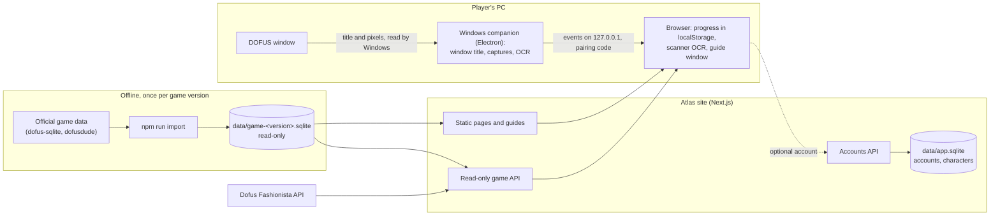
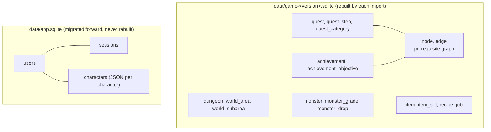
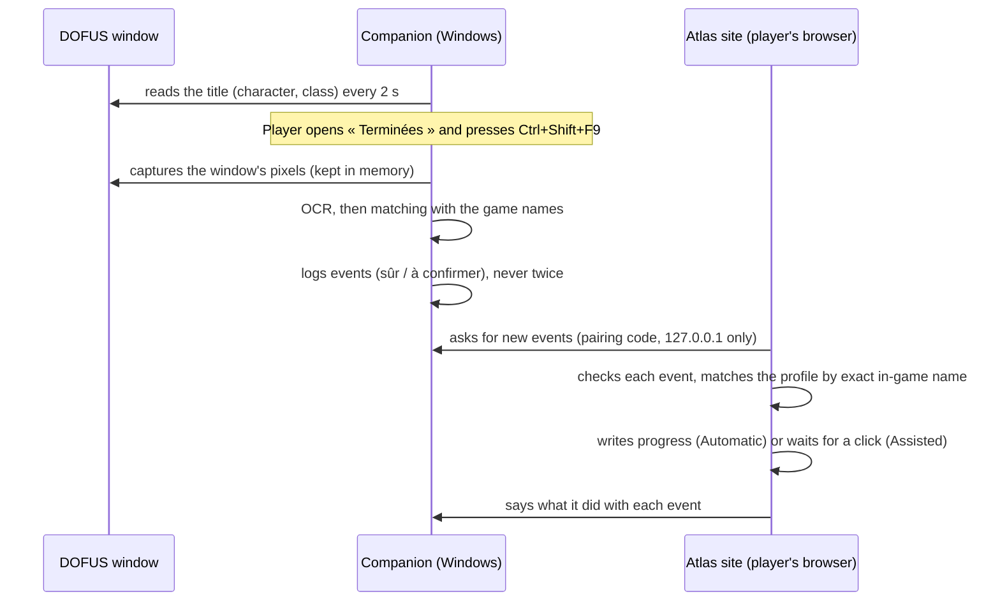

# Atlas des Douze — project overview

> **Start here.** This page explains the project to someone who has never seen the code. **Part 1** needs no technical knowledge. **Part 2** is for developers.
> Every commit is listed in [CHANGELOG.md](../CHANGELOG.md), updated automatically after each push to `main`. The detailed, day-to-day project memory is the Obsidian vault in [`knowledge/`](../knowledge/README.md), whose entry point is [the project dashboard](../knowledge/00%20-%20PROJECT%20DASHBOARD.md).
>
> *Last checked against the repository: 2026-11-25, on branch `docs/project-documentation`. It contains everything on `feature/game-companion`; see [Branches](#branches-where-the-work-is).*

**Status words used on this page**

| Mark | Meaning |
|---|---|
| ✅ | **Built and tested**: code exists, and automated tests pass |
| 🟡 | **Built, not verified for real**: tested on synthetic data or in a browser, not yet confirmed in the real game or in production |
| ⏳ | **Planned**: agreed, not started |
| ⛔ | **Blocked**: waiting on a decision or on data that does not exist |
| ❌ | **Rejected**: decided against, with a recorded reason |

---

# Part 1 — What we are building (non-technical)

## In one paragraph
**Atlas des Douze** is a free companion website for the game **DOFUS** (DOFUS 3, the Unity version, game data 3.7.14.18). It helps a player know **what to do next** and **why**:
- which quests they can start;
- what each Dofus requires;
- which achievements they are close to;
- what their profession can craft.

Everything is computed from the **game's own data files**, not from guesswork. When something is unknown, the site says so instead of inventing it. It is a fan project, not affiliated with Ankama, and **not published online yet**.

## Why it matters
DOFUS has about 2,000 quests and 2,800 achievements, linked by conditions that are hard to follow. Players usually juggle several community sites, wikis and spreadsheets. Atlas brings the official information together, links everything to everything (a quest to its monsters, a monster to its drops, a drop to its recipes), and remembers each character's progress.

## What a player can do today
| | Feature | In plain words |
|---|---|---|
| ✅ | **Quest tracker** | All quests by region, with their real prerequisites and a map of quest chains. Tick what you have done. |
| ✅ | **Achievement journal** | All achievements, what each one asks, where to go, what is almost done. |
| ✅ | **Dofus planner** | The 34 Dofus and the quest or achievement that gives each one. |
| ✅ | **Characters** | Several characters, with their class, level, professions and saved builds. Progress can sync across devices with an optional account. |
| ✅ | **Classes and spells** | The 19 classes and all their spells, with effects in French. |
| ✅ | **Builds** | Community builds from Dofus Fashionista, with stats recomputed from the item data. |
| ✅ | **Encyclopaedia** | Sheets for monsters, items, dungeons, zones and sets, all linked to each other, with exact drop chances. |
| ✅ | **Professions and Atelier** | What each profession can gather or craft, and a shopping list of resources for what you want to craft. |
| ✅ | **« Que faire à mon niveau »** | Zones, monsters and dungeons for a given level. |
| ✅ | **Almanax** | Today's offering and bonus, and the next days. |
| 🟡 | **Scanner** | Show a screenshot, or share the DOFUS window, and the quests or achievements read on screen are marked done. Accurate on test images; **not yet measured on real game screens**. |
| 🟡 | **Windows game companion** | A small Windows program that sees which character you are playing, reads the lists you open in the game, and sends them to the site. It never touches the game. Built and tested, **not yet tried end to end with real game lists**. |
| ✅ | **Always-on-top windows** | A browser window for step-by-step guides, and the companion's overlay, both staying above the game. |

## What we are working on now
1. **Trying the scanner and the Windows companion on real game screens.** Everything passes on test images. The real-game accuracy test is the next step, and the owner has to do it in the game.
2. **Merging the finished work** into the main branch, in order (see [Branches](#branches-where-the-work-is)).
3. **Preparing a public launch.** Several owner decisions are needed first: e-mail provider, hosting, backups, legal review.

## What is not possible, and why
| | What | Why |
|---|---|---|
| ⛔ | XP and kamas routes, market prices | No verified data exists. The game files have no prices, and Atlas never invents numbers. |
| ⛔ | Reading the character's level or server automatically | The game does not show them in its window title, the only place the companion reads without OCR. |
| ❌ | A map inside the site | Built, then removed: it could not be made reliable from the game files. Atlas links to DofusDB and Dofus Maps instead. |
| ❌ | Anything that plays for you, or reads the game's memory | Never. The companion only looks at the screen, like a screen recorder. |

---

# Part 2 — Technical documentation

## Architecture at a glance

**How data flows:**
- **Game data** is imported offline into a read-only SQLite file.
- **The site** builds mostly static pages from it.
- **A player's progress** lives in their browser. With an optional account, it is copied to the account database.
- **The Windows companion** never writes progress itself. It produces events, and the site (in the player's browser) validates and applies them.

Details: [Project architecture](../knowledge/02%20-%20PROJECT%20ARCHITECTURE.md) · [Architecture](../knowledge/05%20-%20Technical%20Documentation/Architecture.md) · [Ecosystem architecture](../knowledge/05%20-%20Technical%20Documentation/Ecosystem%20Architecture.md).

## Technology stack
| Layer | Technology |
|---|---|
| Site | Next.js 16 (App Router), React 19, TypeScript 7, Tailwind CSS 4 |
| Data | SQLite through Node's built-in `node:sqlite` (Node 24+), two separate files |
| OCR (scanner and companion) | Tesseract.js 6.0.1, run on the player's machine |
| Quest graph | `@xyflow/react`, `@dagrejs/dagre` |
| Windows companion | Electron 45.3.0, in its own folder `companion/` with its own dependencies |
| Tests | `node:test` (unit), Playwright with Edge (end to end, desktop and mobile) |
| Automation | GitHub Actions: changelog update on `main` |

Dependencies and the data each one receives: [Integrations](../knowledge/05%20-%20Technical%20Documentation/Integrations.md).

## Database structure
Two SQLite files, kept apart so that a game-data import can never touch player data.

Every table, with row counts: [Database schema](../knowledge/05%20-%20Technical%20Documentation/Database%20Schema.md). The import pipeline: [Data pipeline](../knowledge/05%20-%20Technical%20Documentation/Data%20Pipeline.md).

## External data sources and APIs
| Source | Used for | How |
|---|---|---|
| [dofus-sqlite](https://github.com/ledouxm/dofus-sqlite) | Quests, achievements, spells, monsters, recipes… | Downloaded at import time |
| [dofusdude](https://github.com/dofusdude/dofus3-main) | Items and sets | Downloaded at import time |
| [Dofus Fashionista](https://dofusfashionista.gg) | Community builds | Read-only API, cached for one hour on the server |
| [Dofus Pour Les Noobs](https://www.dofuspourlesnoobs.com/) | Links to quest tutorials | Sitemap at import; content never copied |
| DofusDB, Dofus Maps | Maps | Links only |
| jsDelivr | The OCR model, downloaded on first use | Browser / companion |

Ankama publishes no API for game data or player progress. Atlas never copies or scrapes community sites ([ADR-0003](../knowledge/09%20-%20Development%20Memory/Architecture%20Decision%20Records/ADR-0003%20Link%20community%20sites,%20never%20copy%20them.md)). The site's own API routes: [API documentation](../knowledge/05%20-%20Technical%20Documentation/API%20Documentation.md).

## The Windows companion, step by step

Full design, phase reports, install guide and troubleshooting: [Game companion design](../knowledge/05%20-%20Technical%20Documentation/Game%20Companion%20Design.md). Decision: [ADR-0009](../knowledge/09%20-%20Development%20Memory/Architecture%20Decision%20Records/ADR-0009%20Windows%20companion%20reads%20the%20window%20title%20and%20screen.md).

## Current development status
### Feature status
| Area | Status | Evidence |
|---|---|---|
| Quests, achievements, Dofus, characters, spells, builds, equipment | ✅ | Unit and end-to-end tests |
| Encyclopaedia, atelier, drop odds, level page, Almanax | ✅ | Unit and end-to-end tests (sitemap of 624 URLs crawled) |
| Accounts and sync | ✅ | Tests and a live security probe (2026-11-20) |
| Scanner (screenshot, shared window) | 🟡 | 7/7 names on synthetic game lists; real screens not measured |
| Windows companion, phases 1–9 | 🟡 | 9 of 9 phases built and tested; the real-list accuracy test is pending |
| Always-on-top overlay | 🟡 | Windows reports it topmost and not focusable; look over the game not checked |
| Public launch | ⛔ | Owner decisions: e-mail provider, hosting, backups, legal review ([Release checklist](../knowledge/08%20-%20Security%20and%20Deployment/Release%20Checklist.md)) |

### Companion phases
| Phase | Status |
|---|---|
| 1. Audit · 2. Design | ✅ |
| 3. Window and character detection | ✅ |
| 4–5. Quest and achievement lists | ✅ on synthetic lists · 🟡 real lists |
| 6. Sync with the site | ✅ |
| 7. Several characters and accounts | ✅ · 🟡 two real DOFUS windows not tried |
| 8. Overlay | ✅ · 🟡 look not checked |
| 9. Hardening and tests | ✅ |

### Branches: where the work is
| Branch | Holds | State |
|---|---|---|
| `main` | Everything up to 2026-11-20 | Stable |
| `develop` | Game data foundation, all classes, level page, Almanax, Succès redesign | Not merged into `main` yet |
| `feature/atlas-ecosystem` | Encyclopaedia, atelier, companion window, scanner that saves | Pushed |
| `docs/vault-cleanup` | The vault reorganisation | Pushed |
| `feature/game-companion` | The Windows companion, phases 1–9 | Pushed |
| `docs/project-documentation` | This page, the changelog and its workflow | Pushed |

Merge order: `feature/atlas-ecosystem` → `develop` → `main`, then `docs/vault-cleanup`, `feature/game-companion` and `docs/project-documentation`. The changelog workflow starts working once it reaches `main`.

## Roadmap and remaining tasks
Ordered list, statuses and blocked items: [Project roadmap](../knowledge/01%20-%20PROJECT%20ROADMAP.md). The next ones:
1. ⏳ Owner test of the scanner and companion on real game lists, then calibration.
2. ⏳ Merging the branches (owner).
3. ⏳ Data foundation work (quest objectives with game ids, every subarea, drop fields), findings M2–M4 in [Technical debt](../knowledge/04%20-%20TECHNICAL%20DEBT.md).
4. ⛔ Launch blockers: [Release checklist](../knowledge/08%20-%20Security%20and%20Deployment/Release%20Checklist.md).

## Known bugs and limitations
- 621 of 1,984 quests have conditions the engine cannot fully interpret. They are shown as « à vérifier en jeu », never guessed.
- OCR accuracy on real DOFUS screens is not measured (scanner and companion).
- The companion cannot read level or server, and cannot tell apart two characters with the same name on two servers.
- Monster XP and profession progress are not verified in game.
- Whether Ankama accepts automatic screen reading is not confirmed (UNVERIFIED). Interval capture is off by default.

Full lists: [Development status](../knowledge/03%20-%20DEVELOPMENT%20STATUS.md#known-limitations) · [Technical debt](../knowledge/04%20-%20TECHNICAL%20DEBT.md) · [Bug history](../knowledge/09%20-%20Development%20Memory/Bug%20History/Bug%20History.md).

## Testing and security
| Check | Last result | When |
|---|---|---|
| Typecheck (`npm run typecheck`) | clean | 2026-11-25 |
| Unit tests (`npm test`) | 132/132 passed (137 with the changelog tests of this branch) | 2026-11-25 |
| End to end (`npx playwright test`, desktop and mobile) | 66 passed, 1 skipped by design, 0 failed | 2026-11-25 |
| Dependency audit (`npm audit`, site and companion) | 0 vulnerabilities | 2026-11-25 |
| Security audits | Pre-launch audit and fixes F1–F4 done; open findings F5–F12 listed | 2026-11-20 |

Security controls:
- password hashing (scrypt), hashed session tokens and throttling;
- data isolation between accounts;
- strict security headers;
- the companion reachable from this PC only (127.0.0.1), with a pairing code, Host and Origin checks, and locked windows.

Details: [Security overview](../knowledge/08%20-%20Security%20and%20Deployment/Security%20Overview.md) · [Security audit note](../knowledge/08%20-%20Security%20and%20Deployment/Security%20Audit.md) · [full report](SECURITY_AUDIT.md) · [Privacy (GDPR)](../knowledge/08%20-%20Security%20and%20Deployment/GDPR%20and%20Privacy.md).

## Important technical decisions
| Decision | Why |
|---|---|
| [ADR-0001](../knowledge/09%20-%20Development%20Memory/Architecture%20Decision%20Records/ADR-0001%20Game%20data%20from%20the%20game%20files.md) Game data from the game files | The only reliable source; never invented |
| [ADR-0002](../knowledge/09%20-%20Development%20Memory/Architecture%20Decision%20Records/ADR-0002%20SQLite%20for%20game%20and%20account%20data.md) SQLite for game and account data | No database server needed; two separate files |
| [ADR-0003](../knowledge/09%20-%20Development%20Memory/Architecture%20Decision%20Records/ADR-0003%20Link%20community%20sites,%20never%20copy%20them.md) Link community sites, never copy them | Respect for their work and their terms |
| [ADR-0004](../knowledge/09%20-%20Development%20Memory/Architecture%20Decision%20Records/ADR-0004%20Scanner%20reads%20screenshots%20locally.md) Scanner reads screenshots locally | Screenshots never leave the player's computer |
| [ADR-0005](../knowledge/09%20-%20Development%20Memory/Architecture%20Decision%20Records/ADR-0005%20Remove%20the%20in-site%20map.md) Remove the in-site map | Could not be made reliable |
| [ADR-0006](../knowledge/09%20-%20Development%20Memory/Architecture%20Decision%20Records/ADR-0006%20No%20ads%20or%20analytics%20without%20consent.md) No ads or analytics without consent | Privacy by default |
| [ADR-0007](../knowledge/09%20-%20Development%20Memory/Architecture%20Decision%20Records/ADR-0007%20Profession%20XP%20comes%20from%20the%20player's%20screen.md) Profession XP comes from the player's screen | The XP table is not in the game files |
| [ADR-0008](../knowledge/09%20-%20Development%20Memory/Architecture%20Decision%20Records/ADR-0008%20Companion%20window%20in%20the%20browser.md) Companion window in the browser | Always on top without installing anything |
| [ADR-0009](../knowledge/09%20-%20Development%20Memory/Architecture%20Decision%20Records/ADR-0009%20Windows%20companion%20reads%20the%20window%20title%20and%20screen.md) Windows companion reads the window title and screen | Automatic progress without touching the game |
| [ADR-0010](../knowledge/09%20-%20Development%20Memory/Architecture%20Decision%20Records/ADR-0010%20Changelog%20written%20by%20a%20workflow%20on%20main.md) Changelog written by a workflow on main | Every update visible on GitHub without asking |

## Where to find more
| To… | Open |
|---|---|
| See every change, with links to GitHub | [CHANGELOG.md](../CHANGELOG.md) |
| Browse the whole project memory (best in Obsidian) | [knowledge/00 - PROJECT DASHBOARD.md](../knowledge/00%20-%20PROJECT%20DASHBOARD.md) |
| Find any note or report | [Documentation index](../knowledge/05%20-%20DOCUMENTATION%20INDEX.md) |
| Run the project | [README.md](../README.md) (in French) and [Quick links](../knowledge/00%20-%20Dashboard/Quick%20Links.md) |
| Read long reports | [`docs/`](.) — for example [GAME_DATA_INVENTORY.md](GAME_DATA_INVENTORY.md), [PR2_TECHNICAL_REVIEW.md](PR2_TECHNICAL_REVIEW.md), [RELEASE_READINESS.md](RELEASE_READINESS.md) |
