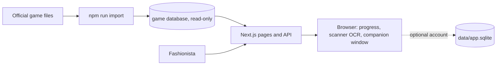

# Project architecture

How the whole thing works, in one page, and which note explains each part. The details stay in the linked notes; this page does not copy them.

## In one paragraph
1. An offline import (`npm run import`) reads the official game files and writes one read-only SQLite database per game version.
2. The Next.js site reads that database to build mostly static pages: quests, achievements, encyclopaedia, professions, guides.
3. The player's progress stays in the browser, or, with an optional account, in a second SQLite database (`data/app.sqlite`).
4. Everything that reads the player's screen (the scanner, the companion window) runs in the browser. Nothing touches the game client.

## Where each part is explained
| Part | Note | Main code |
|---|---|---|
| Layers, pages, prerequisites, where state lives | [[Architecture]] | `src/`, `app/` |
| How the modules link to each other: encyclopaedia, atelier, companion | [[Ecosystem Architecture]] | `src/encyclopedia.ts` |
| Import of the game files | [[Data Pipeline]] | `scripts/import.ts` |
| Tables of both databases | [[Database Schema]] | `src/server/appdb.ts` |
| API routes | [[API Documentation]] | `app/api/` |
| Accounts and sessions | [[Authentication]] | `src/server/auth.ts` |
| Scanner (OCR in the browser) | [[Character Sync OCR]] | `components/scan/ocr.ts`, `src/recognize.ts` |
| Windows game companion (phase 3 built) | [[Game Companion Design]] | `companion/main.mjs`, `src/game-window.ts` |
| Companion window (always on top) | [[Companion Window]] | `components/companion/` |
| Outside services and dependencies | [[Integrations]] | `package.json` |
| Security headers, audits | [[Security Overview]] · [[Security Audit]] | `next.config.ts` |
| Hosting (not deployed) | [[Infrastructure]] | `.env.example` |
| UI system | [[Components]] · [[Visual Identity]] | `components/ui.tsx` |

## Decisions that shape the architecture
- [[ADR-0001 Game data from the game files]]
- [[ADR-0002 SQLite for game and account data]]
- [[ADR-0003 Link community sites, never copy them]]
- [[ADR-0004 Scanner reads screenshots locally]]
- [[ADR-0005 Remove the in-site map]]
- [[ADR-0006 No ads or analytics without consent]]
- [[ADR-0007 Profession XP comes from the player's screen]]
- [[ADR-0008 Companion window in the browser]]
- [[ADR-0009 Windows companion reads the window title and screen]]

Known weaknesses: [[04 - TECHNICAL DEBT]].
