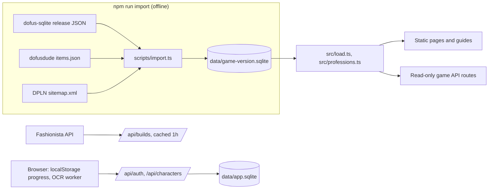

# Architecture

*Verified against the code on 2026-11-20.*

## Layers
| Layer | Where | Notes |
|---|---|---|
| Game data import | `scripts/import.ts`, `scripts/professions-import.ts` | Builds one SQLite file per game version and writes `data/report-<version>.json` |
| Pure engine | `src/criteria.ts`, `src/codes.ts`, `src/graph.ts`, `src/views.ts`, `src/layout.ts`, `src/regions.ts`, `src/effects.ts`, `src/spells.ts`, `src/stats.ts`, `src/recognize.ts`, `src/character.ts` | Tested with `node:test`; shared by server and browser |
| Data access | `src/load.ts`, `src/professions.ts` | Read-only, parameterised SQL |
| Accounts | `src/server/auth.ts`, `src/server/appdb.ts` | See [[Authentication]] |
| Routes | `app/` (App Router) | Mostly static pages; dynamic: `/api/auth`, `/api/characters`, `/api/builds` |
| UI | `components/` (per section) and `components/ui.tsx` (shared) | See [[Components]] |

## How quest prerequisites work
1. **Conditions:** each quest has a `startCriterion` expression in the game files, such as `PL>129&(Qf=272|Qf=273)&Qa!496`.
2. **Parsing:** `src/criteria.ts` turns it into a boolean tree, and `src/graph.ts` compiles that into nodes and edges:
   - `Qf=X` becomes a `requires` edge;
   - `(A|B)` becomes an OR gate;
   - `Qa!X` becomes an `excludes` edge;
   - `PL>N` becomes a level condition.
3. **Unknown codes** become "not interpreted" conditions, which never block silently. Their meaning and sources are listed in `src/codes.ts`.
4. **Status** is a pure function of progress and level: done, available, locked (listing what is missing) or excluded.

Current counts are in [[Quests]].

## Where state lives
- **No account:** everything in the browser (`localStorage` key `dofus-companion:characters:v2`).
- **With an account:** characters are synced to `data/app.sqlite` through `/api/characters`. A newer copy from another device wins (409).

## Planned versus built
The original plan (`docs/RAPPORT_ARCHITECTURE.md`) proposed Kysely, better-sqlite3, PostgreSQL, Vitest and elkjs. The built system uses:
- `node:sqlite` only ([[ADR-0002 SQLite for game and account data]]);
- `node:test`;
- `@xyflow/react` with `dagre`.

Related: [[Database Schema]] · [[Data Pipeline]] · [[API Documentation]].
