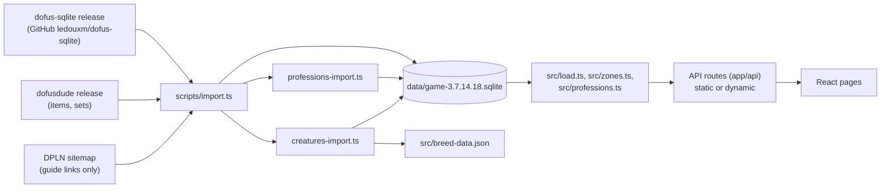
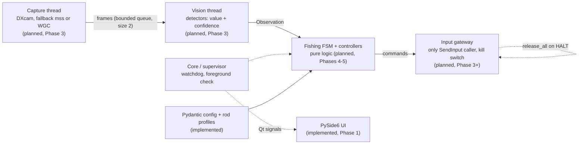
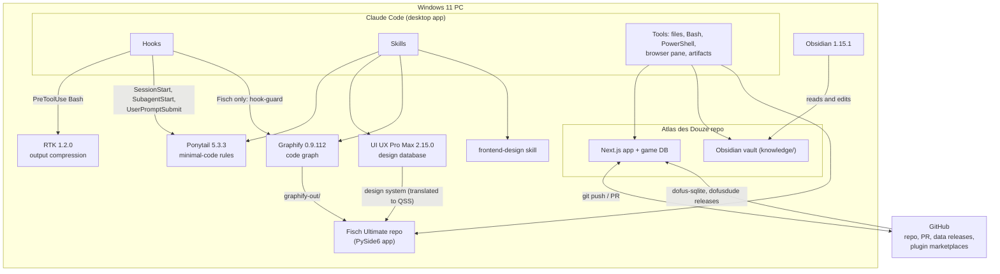
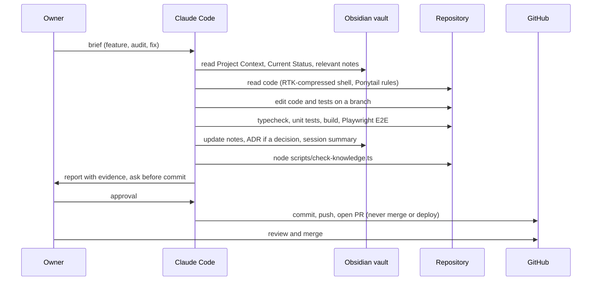
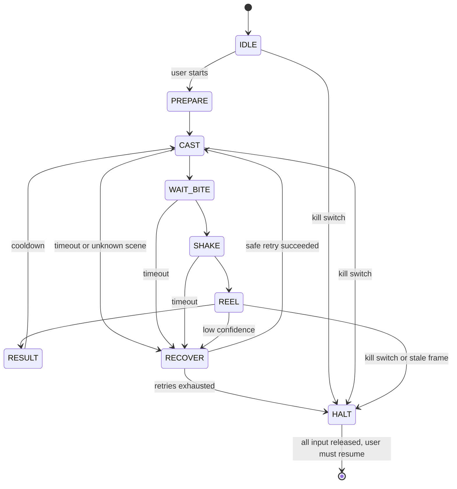

# Complete System Documentation

The central reference for everything built, installed and configured in this workspace up to **2026-11-21**: what each component is, how it works, where it runs, what it is good for, and how the parts fit together.

> [!info] How this document was made
> Every statement comes from files read on this PC on 2026-11-21: configuration files, installed binaries (`--version`), plugin folders, repositories, Git history, project status files and the vault. When something could not be checked, it says **UNVERIFIED**. "Discussed" never counts as "installed": tools are only listed as installed when a binary or plugin folder was found. Nothing was changed while auditing.
> **Status labels:** **Working** (verified functionality), **Configured** (installed and set up, use not verified), **In Development** (partly built), **Planned** (discussed, not installed), **Deprecated** (superseded), and **External** (third-party software on the PC that we use or study but did not build).

## Table of contents
1. [[#1. The ecosystem at a glance]]
2. [[#2. Claude Code layer (AI tooling)]]
3. [[#3. Knowledge layer (Obsidian)]]
4. [[#4. Atlas des Douze (DOFUS companion website)]]
5. [[#5. Fisch Ultimate: the custom macro system]]
6. [[#6. Third-party macro software and references]]
7. [[#7. Local utilities and runtimes]]
8. [[#8. How everything works together]]
9. [[#9. Which Tool Should I Use?]]
10. [[#10. Current state assessment]]
11. [[#11. Inventory of every component]]

---

## 1. The ecosystem at a glance

There are three **projects** and one **tooling layer** shared by all of them:

| Area | What it is | Where it lives | State |
|---|---|---|---|
| **Claude Code tooling** | The AI assistant and the add-ons that change how it works: RTK (output compression), Ponytail (minimal-code discipline), Graphify (code knowledge graph), UI UX Pro Max (design database), personal skills, hooks | `C:\Users\kakii\.claude\` (user scope) plus per-project `.claude\` folders | Working |
| **Atlas des Douze** | DOFUS 3 (Unity) companion website: quests, achievements, classes, professions, level page, Almanax, builds | `C:\Users\kakii\Documents\Atlas-des-Douze` (GitHub `itsuko-rt/dofus-companion`) | Working locally, not deployed |
| **Obsidian vault** | The project memory of Atlas des Douze: status, decisions, bugs, research, session summaries | `C:\Users\kakii\Documents\Atlas-des-Douze\knowledge` | Working |
| **Fisch Ultimate** | Our own Windows macro for the Roblox game *Fisch*, built from scratch on screen capture and standard input | `C:\Users\kakii\Documents\Fisch-Ultimate` | In Development (Phase 1 of 10 done) |

Everything runs on **one Windows 11 Pro PC** (build 10.0.26200). There is no server: Atlas des Douze runs with `next start` on `127.0.0.1`, and Fisch Ultimate is a desktop application. The only online services involved are GitHub (code hosting, game-data releases), the Claude service behind Claude Code, and the plugin marketplaces on GitHub.

---

## 2. Claude Code layer (AI tooling)

### 2.1 Claude Code (desktop app, Code tab) — Working
- **What:** Anthropic's coding agent. In this workspace it runs inside the **Claude desktop app** (Code tab), with file, shell (Git Bash and PowerShell), browser-pane and artifact tools. All the work in this vault was done through it.
- **How it works:** each session reads instructions in layers: the user file `~/.claude/CLAUDE.md`, then the project's `CLAUDE.md`. It then runs tools on the PC. **Hooks** (commands declared in settings files) run before or after tool calls and at session start. They let RTK, Ponytail and Graphify plug in without changing Claude Code itself. **Skills** are folders with a `SKILL.md` that Claude loads when a task matches or when you type `/<skill-name>`. **Plugins** bundle skills, hooks and commands, installed from GitHub "marketplaces".
- **Where:** user configuration in `C:\Users\kakii\.claude\` (`settings.json`, `CLAUDE.md`, `RTK.md`, `skills\`, `plugins\`). Per-project configuration in `<project>\.claude\` and `<project>\CLAUDE.md`. Session transcripts and memory in `~/.claude/projects/`.
- **User settings** (`~/.claude/settings.json`, read on 2026-11-21):
  - `enabledPlugins`: `ponytail@ponytail`, `ui-ux-pro-max@ui-ux-pro-max-skill`;
  - `extraKnownMarketplaces`: GitHub repositories `DietrichGebert/ponytail` and `nextlevelbuilder/ui-ux-pro-max-skill`;
  - `hooks.PreToolUse`: on the `Bash` tool, run `rtk hook claude`.
- **User instructions** (`~/.claude/CLAUDE.md`): imports `@RTK.md` (how to read compressed output) and declares the personal `graphify` skill with its `/graphify` trigger.
- **Backups made during setup:** `~/.claude/backups/pre-rtk-20261119-004620/` and `~/.claude/settings.json.bak` (the pre-RTK version, without the hook).
- **Good at:** programming, debugging, refactoring, research with sources, documentation, and driving browsers and test runners.
- **Not designed for:** running unattended in the background without a session, or deploying anything by itself (our rules forbid merge and deploy without approval).

### 2.2 RTK — "Rust Token Killer" 1.2.0 — Working
- **What:** an open-source command-line proxy (Rust, project `rtk-ai/rtk`) that **compresses command output before it reaches the AI**, so fewer tokens are spent reading `git`, `ls`, `grep`, test and build output.
- **How it works:**
  1. Claude Code calls the `Bash` tool.
  2. The `PreToolUse` hook runs `rtk hook claude`, which **rewrites the command** to its `rtk` equivalent (for example `git status` → `rtk git status`, `cat f` → `rtk read f`).
  3. RTK runs the real command and filters the output: it strips noise, groups repeated lines and truncates long lists.
  4. When it cuts something, it leaves a `rtk recall <hash>` line so the full text can be retrieved. `rtk bypass <cmd>` runs a command unfiltered.
  5. It records savings in a local history (`rtk gain`).
  6. Custom filters are TOML files: user scope `%APPDATA%\rtk\filters.toml` (currently only the commented example); project scope `.rtk/filters.toml`, after `rtk trust`.
- **Where:** binary `C:\Users\kakii\AppData\Local\Microsoft\WinGet\Packages\rtk-ai.rtk_Microsoft.Winget.Source_8wekyb3d8bbwe\rtk.exe` (installed with `winget install --id rtk-ai.rtk --exact`, on the user PATH). The hook is in `~/.claude/settings.json`; the reading rules are in `~/.claude/RTK.md`.
- **Evidence of use:** `rtk gain` on 2026-11-21: **894 commands, 33.0K tokens saved (16.6% overall)**. The biggest savings came from `next build` (96%), `git add` (93%) and `diff` (98%). `grep` is the most frequent command (361 runs, 25% saved).
- **Inputs / outputs:** a shell command in; the same command's output, condensed, out.
- **Good at:** cutting the cost of verbose command output (builds, test runs, directory listings, Git).
- **Limits:**
  - It hooks **only the Bash tool**: commands run through the PowerShell tool are not compressed.
  - Filtering can hide a line you needed; use `rtk recall` or `rtk bypass`.
  - Because the hook rewrites commands, **Claude's auto mode sometimes cannot review the rewritten command** (seen on 2026-11-21: "a hook changed this call's input after auto mode reviewed it"). The command then has to be resent.

### 2.3 Ponytail 5.3.3 — Working
- **What:** an open-source Claude Code plugin (author Dietrich Gebert, GitHub `DietrichGebert/ponytail`, installed 2026-11-18). It makes the assistant behave like a "lazy senior developer": the smallest complete change, reuse before writing new code, no unrequested abstractions, and a one-line note of what was skipped.
- **How it works:**
  - *Hooks* (`hooks/claude-codex-hooks.json`):
    - `SessionStart` (on startup, resume, clear, compact) runs `ponytail-activate.js`, which injects the Ponytail rules into the session;
    - `SubagentStart` passes the same rules to subagents;
    - `UserPromptSubmit` runs `ponytail-mode-tracker.js`, which notices level changes (`/ponytail lite|full|ultra`, "stop ponytail").
  - *State:* the current level is stored in `~/.claude/.ponytail-active` (currently `full`). Per-session mode files are in `~/.claude/ponytail-modes/`.
  - *Skills:* `ponytail`, `ponytail-review` (code review), `ponytail-audit` (whole-repository audit), `ponytail-debt` (lists `shortcut:` comments), `ponytail-gain` (benchmark savings) and `ponytail-help`. Each has a matching TOML command file.
  - *"Band" ledger:* after every turn it writes the task's row (cost, turns, tokens, reuse, tests) to a CSV per project in `C:\Users\kakii\.config\ponytail\band\`, viewable in `board.html`. CSV files exist for Fisch Ultimate and for two Atlas sessions.
- **Where:** `C:\Users\kakii\.claude\plugins\cache\ponytail\ponytail\5.3.3\`.
- **Good at:** keeping diffs small, reviews (`/ponytail-review`), finding bloat (`/ponytail-audit`), and listing deliberate shortcuts (`/ponytail-debt`).
- **Not designed for:** design or creative work, or research. It is a discipline layer, not a capability.
- **Notes:**
  - A status-line script (`~/.claude/ponytail-statusline.ps1`, which prints `[PONYTAIL]` in colour) exists but is **not wired**: `settings.json` has no `statusLine` entry.
  - `Fisch-Ultimate\docs\TOOLING.md` says the ledger option was "left unset". The ledger defaults to on, which is why the CSV files exist. The webhook is empty, so nothing leaves the PC.

### 2.4 Graphify 0.9.112 — Working (used in Fisch Ultimate only)
- **What:** an open-source tool (GitHub `Graphify-Labs/graphify`, PyPI package **`graphifyy`**, command `graphify`). It turns a folder of code and documents into a **knowledge graph** (nodes = files, classes, functions and concepts; edges = calls, imports, references), then answers questions by graph traversal instead of raw file reading.
- **How it works:**
  1. `graphify update .` parses code with an AST parser. It is local and free, with no AI call. Documents, images and video need the semantic mode, which does use a model.
  2. It runs community detection (clusters of related nodes), finds "god nodes" (the most connected), and labels each edge EXTRACTED, INFERRED or AMBIGUOUS.
  3. It writes `graphify-out/graph.json` (the graph), `graph.html` (interactive view), `GRAPH_REPORT.md` (plain-language summary) and a cache.
  4. Queries: `graphify query "<question>"`, `graphify path "<A>" "<B>"`, `graphify explain "<concept>"`, `graphify section "<heading>"`. Each returns a small subgraph, usually far fewer tokens than grepping and reading files.
  5. Optional: `--mcp` (server for agents), `--watch`, `--wiki`, `--obsidian` (write the graph as a vault), Neo4j or FalkorDB export.
- **Where:**
  - *Binaries:* `C:\Users\kakii\.local\bin\graphify.exe` and `graphify-mcp.exe`, installed with `uv tool install graphifyy`.
  - *Personal skill:* `~/.claude/skills/graphify/SKILL.md`, plus 8 reference files.
  - *Fisch Ultimate:* project hooks in `Fisch-Ultimate\.claude\settings.json`:
    - before `Bash|Grep`: `graphify hook-guard search`;
    - before `Read|Glob`: `graphify hook-guard read`;
    - at `SessionStart` (compact): `graphify hook-guard compact`.

    These remind Claude to query the graph first. A `## graphify` section in `Fisch-Ultimate\CLAUDE.md` gives the rules, and `Fisch-Ultimate\.graphifyignore` keeps it to code only: docs, Markdown, images, recordings and the venv are excluded.
- **Existing graph:** `Fisch-Ultimate\graphify-out\` holds **208 nodes, 538 edges, 10 communities**. It was built from commit `c94ade64`, but the repository is now at `7ee7b62`, so the graph is **stale** until `graphify update .` is run. Token cost of the build: 0 (AST only).
- **Atlas des Douze:** not set up. No graph, no hooks.
- **Good at:** architecture questions, "what calls what", tracing relationships across many files, onboarding to an unfamiliar codebase.
- **Not good at:** single lookups in a small codebase (a plain search is cheaper). It needs rebuilding after changes, and semantic extraction of documents costs model tokens.
- **Privacy rule** (`Fisch-Ultimate\docs\GRAPHIFY.md`): local parsing only, with `GRAPHIFY_BACKEND=none` and `GRAPHIFY_QUERY_LOG_DISABLE=1`.

### 2.5 UI UX Pro Max 2.15.0 — Working (core search); image skills Configured
- **What:** an open-source Claude Code plugin (author `nextlevelbuilder`, MIT). It is a **local design-knowledge database plus a search engine**: 80 styles, 194 palettes, 74 font pairings, 25 chart types and 22 technology stacks, stored as about 90 CSV files.
- **How it works:**
  1. The skill tells Claude to run `python "${CLAUDE_PLUGIN_ROOT}/.claude/skills/ui-ux-pro-max/scripts/search.py" "<query>" --domain <domain>`, or with `--design-system -p "<Project>"`.
  2. The Python script needs no extra package. It scores the CSV rows against the query and returns a complete design system: style, palette, typography, spacing and accessibility rules.
  3. Options: `--persist` writes a design-system folder, `--tokens css|dtcg` exports design tokens, `--preview` makes a preview page.
- **Skills (7):**
  - `ui-ux-pro-max` (the search engine);
  - `design-system` (token architecture);
  - `ui-styling` (shadcn/Tailwind);
  - `design` (logos, corporate identity, icons, social images);
  - `brand`;
  - `banner-design`;
  - `slides` (HTML presentations with Chart.js).
- **Where:** `C:\Users\kakii\.claude\plugins\cache\ui-ux-pro-max-skill\ui-ux-pro-max\2.15.0\`. It runs with the system Python (`python` = **Python 3.12.10**).
- **Evidence of use:** `Fisch-Ultimate\docs\DESIGN_SYSTEM.md`. The query "desktop control panel monitoring tool dark" produced the "Minimalism & Swiss" style and the "Dark tech + status green" palette. These were translated by hand into Qt: native Segoe UI instead of a web font, `COLORS`/`SPACE`/`FONT_PX` dictionaries turned into QSS. There is no evidence of its use in Atlas des Douze.
- **Limits:**
  - The output is web-oriented and must be translated for desktop toolkits.
  - The `design` and `banner-design` image generation needs external API keys (Gemini, Atlas Cloud, MuAPI, UberLLM). **None are configured**, so those parts are unverified.
  - Some skill files call `python3`, which on this PC is the **Microsoft Store shortcut and fails**. Use `python` instead.

### 2.6 Personal skill: frontend-design — Configured
- **What:** a skill in `~/.claude/skills/frontend-design/` (`SKILL.md` plus a licence file). It gives guidance for distinctive visual design (aesthetic direction, typography, avoiding template looks) when building or reshaping a UI.
- **How it works:** pure instructions. Claude loads it when a UI-design task matches; there are no scripts.
- **Overlap:** it covers the same ground as UI UX Pro Max. frontend-design gives *art direction*; UI UX Pro Max gives *data* (palettes, font pairings, stack rules). No session record shows which one shaped Atlas des Douze's "Emerald Egg" identity: **UNVERIFIED**.

### 2.7 Project subagents (Fisch Ultimate) — Configured
Four agent definitions in `Fisch-Ultimate\.claude\agents\` (copies in `Fisch-Ultimate\docs\agents\`):

| Agent | Tools | Job |
|---|---|---|
| `architecture` | Read, Grep, Glob | Design modules, interfaces and state machines; no production code |
| `development` | — | Implement approved phase tasks in small, tested increments |
| `qa` | — | Independent verification: run tests, check claims against evidence |
| `research` | — | Fisch ecosystem and mechanics research with cited sources, labelled verified / assumed / unknown |

They are invoked by asking Claude to use the named agent. Their use after Phase 1 is not recorded.

### 2.8 Repomix 1.19.0 — Configured
- **What:** an open-source CLI that packs a repository (or chosen files) into **one text file** to paste into an AI.
- **Where:** global npm install, `C:\Users\kakii\AppData\Roaming\npm\repomix.cmd`.
- **Rule in `Fisch-Ultimate\CLAUDE.md`:** pack selectively (`repomix --include "src/**/*.py"`), never the whole repository with lockfile and data.
- **Evidence of use:** none found. Complementary to Graphify: Repomix sends *all the text*, Graphify sends *the relevant structure*.

### 2.9 Context7 and Serena — Planned
Named in `Fisch-Ultimate\CLAUDE.md`: Context7 "only for third-party API questions (DXcam, PySide6, OpenCV)", Serena "on demand for symbol navigation". **Neither is installed.** There is no command on the PATH, no `mcpServers` entry in `~/.claude/.claude.json`, and no `.mcp.json` in the project.

### 2.10 Claude desktop built-in tools used in our work — Working
These come with the desktop app; we did not install them, but the projects depend on them:
- **Browser pane** (an embedded browser): used to review the running Atlas site, inspect pages and take screenshots.
- **Playwright with Microsoft Edge** (`channel: msedge`, no browser download): the Atlas E2E suite and screenshot scripts. Playwright is an npm dev dependency of Atlas.
- **Artifacts and file sharing:** used to show screenshots and reports.
- **Session memory directory** (`~/.claude/projects/<project>/memory/`): available. No memories stored for this project at audit time.

---

## 3. Knowledge layer (Obsidian)

### 3.1 Obsidian app and vault registration — Working
- **What:** Obsidian 1.15.1, a desktop Markdown knowledge base. The vault is a plain folder of `.md` files; Obsidian adds links, a graph view, properties and Bases (database views).
- **Where:** the app configuration is `%APPDATA%\obsidian\obsidian.json`. It registers **one vault**: `C:\Users\kakii\Documents\Atlas-des-Douze\knowledge`, written directly while Obsidian was closed because the `obsidian://` URI did not register it. Backup: `%APPDATA%\obsidian\obsidian.json.bak-2026-11-20`. The vault configuration is in `knowledge\.obsidian\`.
- **Vault settings:**
  - `app.json`: links update on rename; new notes go to `06 - Research and Sources/Research Archive`; attachments go to `Attachments`.
  - `templates.json`: folder `Templates`, date format `YYYY-MM-DD`.
- **Core plugins enabled (20):** file explorer, search, quick switcher, graph, backlinks, outgoing links, tags, page preview, **templates**, outline, properties, bookmarks, command palette, editor status, **canvas**, note composer, file recovery and **bases**. Daily notes, sync, publish and web viewer are off.
- **Community plugins: none** (by rule: "Do not install community plugins").
- **Verified behaviour** ([[Setup Report]]): the French command « Modèles: Insérer le modèle » inserts all 5 templates. The Bases view [[Research.base]] renders 20 notes in 3 groups. Settings survive a restart.

### 3.2 Vault structure — Working
98 notes in numbered folders. The dashboard is [[Home]], with [[Current Status]] and [[Quick Links]].

| Folder | Content |
|---|---|
| `00 - Dashboard` | [[Home]], [[Current Status]], [[Project Overview]], [[Quick Links]], [[Setup Report]] |
| `01 - Project Management` | [[Feature Backlog]], [[Product Roadmap]], [[Milestones]], [[Priorities]], [[Vision and Goals]] |
| `02 - Game Knowledge` | DOFUS research: classes ([[Cra]], [[Pandawa]]), quests, achievements, dungeons, monsters, spells, mechanics |
| `03 - Builds and Progression` | [[Cra Builds]], [[Pandawa Builds]], [[Equipment]], [[XP Routes]], [[Kamas Routes]] |
| `04 - Professions` | [[Professions]] and one note per profession |
| `05 - Technical Documentation` | [[Architecture]], [[Data Pipeline]], [[Database Schema]], [[API Documentation]], [[Authentication]], [[Character Sync OCR]], [[Integrations]], this document |
| `06 - Research and Sources` | [[Official Sources]], [[Community Sources]], [[Verification Status]], [[Research Log]], [[Research Archive]], [[Research.base]] |
| `07 - Design System` | [[Visual Identity]], [[UI UX Guidelines]], [[Components]], [[Design Decisions]] |
| `08 - Security and Deployment` | [[Security Overview]], [[Security Audit]], [[GDPR and Privacy]], [[Infrastructure]], [[Release Checklist]] |
| `09 - Development Memory` | ADRs (7, e.g. [[ADR-0001 Game data from the game files]]), [[Bug History]], [[Lessons Learned]], [[Development Logs]], [[Session Summaries]] |
| `10 - Claude Code` | [[Project Context]], [[Operating Instructions]], [[Coding Standards]], [[Documentation Rules]] |
| `Templates` | Development Session, Architecture Decision, Bug Report, Feature Specification, Research Template |

- **How Claude uses it:** the Atlas `CLAUDE.md` tells Claude to read [[Project Context]] and [[Current Status]] before a task, then only the notes the task needs, using the table in [[Operating Instructions]]. After significant work Claude updates the matching notes, writes a session summary and runs the checker.
- **Line endings:** `.gitattributes` forces LF for `knowledge/**`.

### 3.3 Vault checker `scripts/check-knowledge.ts` — Working
Run with `node scripts/check-knowledge.ts` from the repository root. It checks that:
- every `[[link]]` and `[[link#heading]]` resolves;
- note names are unique;
- every repository path written in code style (under docs, src, scripts, app, components, tests, e2e, migrations or public) exists;
- the required notes exist;
- no line looks like a secret or an e-mail address.

It exits 1 on any problem. It does not judge whether content is true; that rests on the labels VERIFIED, COMMUNITY, UNVERIFIED, OUTDATED and HYPOTHESIS ([[Verification Status]]).

---

## 4. Atlas des Douze (DOFUS companion website)

### 4.1 Identity and state — Working locally, not deployed
- **What:** a French-language companion site for DOFUS 3 (Unity, game data version **3.7.14.18**), custom-built. Quest tracker with a prerequisite graph, achievements, Dofus, 19 class pages with spells, professions with an XP calculator, the "Que faire à mon niveau" level page, daily Almanax, community builds, equipment search, a screenshot scanner (OCR), characters and accounts.
- **Repository:** `C:\Users\kakii\Documents\Atlas-des-Douze`, remote `https://github.com/itsuko-rt/dofus-companion.git`. Branches: `main`, `develop` (holds PR #2, reviewed, fixed and **not merged**: [[2026-11-20 PR 2 pre-merge fixes]]), docs/obsidian-setup, docs/product-audit and docs/system-documentation (branch names, not folders).
- **Stack:**
  - Next.js 16 and React 19, TypeScript 7, Tailwind 4;
  - `node:sqlite` (Node 26) for the game and account databases;
  - `@xyflow/react` with `@dagrejs/dagre` for the quest graph, `tesseract.js` 6 for OCR, `lucide-react` icons;
  - `node:test` and Playwright for tests.
- **Status:** see [[Current Status]]. Typecheck clean, 90/90 unit tests, E2E 47 passed and 1 skipped by design (2026-11-20).

### 4.2 Data pipeline — Working

- **Run:** `npm run import`, i.e. `node --max-old-space-size=8192 scripts/import.ts`. The raw files are cached in `data/raw/`; the output is one immutable SQLite file per game version. Partial rebuilds: `node scripts/professions-import.ts` and `node scripts/creatures-import.ts`.
- **Rules:**
  - game data comes only from the game files ([[ADR-0001 Game data from the game files]]);
  - community sites are linked, never copied ([[ADR-0003 Link community sites, never copy them]]);
  - profession XP comes from the player's screen ([[ADR-0007 Profession XP comes from the player's screen]]).
- **What is missing from the data** (`docs/GAME_DATA_INVENTORY.md`): the profession XP table, XP per craft, prices, and verified monster XP. The open data-foundation work is listed in `docs/PR2_TECHNICAL_REVIEW.md` §11–12.
- **DofusDB:** used only as a design reference. Its API licence (LPNC-IA 1.0) forbids AI ingestion, so its data is never used.

### 4.3 Application architecture
- **Server-side loaders** (`src/*.ts`) open the game database read-only through `node:sqlite`. Client code never imports them: shared types and pure logic live in `*-shared.ts` files.
- **Static routes** (`dynamic = 'force-static'`: `/api/graph`, `/api/zones`, `/api/almanax`) are built once and served as files. Dynamic routes cover search, quest details, accounts and characters.
- **Character state:** `components/useCharacter.ts`, an external store (`useSyncExternalStore`) kept in `localStorage`, with optional account sync to `data/app.sqlite`.
- **Details:** [[Architecture]], [[Database Schema]], [[API Documentation]], [[Authentication]], [[Character Sync OCR]].

### 4.4 Scripts (all in `scripts/`)
| Script | Purpose | Run |
|---|---|---|
| `scripts/import.ts` | Build the game database from the releases | `npm run import` |
| `scripts/professions-import.ts` | Professions, zones, recipes | `node --max-old-space-size=8192 scripts/professions-import.ts` |
| `scripts/creatures-import.ts` | Classes, monsters, drops, XP table, activities, Almanax | `node --max-old-space-size=8192 scripts/creatures-import.ts` |
| `scripts/check-knowledge.ts` | Vault checker | `node scripts/check-knowledge.ts` |
| `scripts/make-icons.ts` | Favicons, app icons and social image from `brand/` | `node scripts/make-icons.ts` |
| `scripts/fetch-assets.ts` | Download official artwork into `public/ankama/` (git-ignored, never committed) | `npm run assets` |
| `scripts/smoke.ts` | End-to-end smoke test of a running server | `node scripts/smoke.ts [baseUrl]` |
| `scripts/check-links.ts` | Broken-link and SEO check of a running server | `node scripts/check-links.ts` |
| `scripts/security-probe.mjs` | OWASP-style probe of a local server you own | `npm run security-probe` |
| `scripts/export-d1-migrations.ts` | Write account migrations for Cloudflare D1 (deployment preparation; no deployment exists) | `node scripts/export-d1-migrations.ts` |
| `scripts/layout-report.ts` | Quest-chain width and region size per category | `node scripts/layout-report.ts` |
| `scripts/profile-codes.ts` | Developer tool: criterion codes and their value shapes | `node scripts/profile-codes.ts` |

### 4.5 Quality checks
```powershell
npm run typecheck
```
```powershell
npm test
```
```powershell
npm run build
```
The E2E suite needs a production server first: `next start -p 3100` (or `3101`), then run `npx playwright test`, with `E2E_BASE_URL` set when the port is not 3100. The latest results are recorded in `docs/PR2_TECHNICAL_REVIEW.md` §12.2.

### 4.6 Related local material
- `C:\Users\kakii\Documents\Atlas-des-Douze-reference-audit`: desktop and mobile screenshots plus a control inventory of 23 DofusDB pages (2026-11-20). They contain DofusDB and Ankama imagery: keep them local.
- `C:\Users\kakii\Downloads\Dofus_Solo_Roadmap_Research.zip`: Cra and Pandawa level-band CSVs, profession starter routes and an 18 KB dossier. It is community advice and **not yet in the repository**.
- An older session copy of the repository lives in the Claude scratch workspace (branch docs/obsidian-setup, last commit `2dd13fd`). It disappears when that session is deleted; the permanent clone is the one above.

---

## 5. Fisch Ultimate: the custom macro system

### 5.1 Original objective
A **Windows desktop fishing automation for the Roblox game *Fisch***, rebuilt from zero (the old Phase 1–2 project must not be reused). It is designed around fail-safe behaviour rather than raw speed. Hard rules (`Fisch-Ultimate\CLAUDE.md`):
- **External screen capture and standard input only.** No code injection, no memory reading, no anti-cheat bypass, no network interference, never Roblox credentials, never a promise of being undetectable.
- **One input gateway:** only the gateway module may send input. Every key or button *down* is paired with an *up*, and a kill switch releases everything.
- **Fail closed:** low confidence, a stale frame or an unknown scene means release all input and **HALT**. It never clicks blindly.
- No competitor code is copied: Scarlet Hub has no licence, freew-w is GPLv3, XTernal is AGPL. Ideas only.
- No invented rod statistics. Data is marked `source_verified` only once measured.

### 5.2 Architecture (from `Fisch-Ultimate\RESEARCH_AND_TECHNICAL_SPECIFICATION.md` §4)

**State machine (planned):** `IDLE → PREPARE → CAST → WAIT_BITE → SHAKE → REEL → RESULT → (COOLDOWN) → CAST`, plus `RECOVER` (bounded safe retries) and `HALT` (all input released; the user must resume). Every state has a timeout and an exit-on-unknown rule.

**Reel controller (planned):**
- a Kalman estimate of the fish and bar positions;
- online identification of how the bar responds;
- a short-horizon predictive hold/release decision;
- duty-cycle actuation decoupled from the vision frame rate.

A PD controller is the fallback, then *release and HALT*. The choice must be made from replays of recorded fights, not by argument.

### 5.3 What is actually implemented (Phase 0 and 1, `Fisch-Ultimate\PROJECT_STATUS.md`, 2026-11-19)
| Part | Status | Evidence |
|---|---|---|
| Phase 0: environment checks (Windows 11, Python 3.12.10, 1920×1080 at 100%; PySide6 6.12.0, NumPy 2.5.5, OpenCV 5.1.0.95, DXcam 0.3.0, Pydantic 2.14.3 import) | Working | diagnostics checks |
| Phase 0: open-source macro research (36 techniques scored) | Done | `Fisch-Ultimate\docs\research\` |
| App launch: `uv run fisch-ultimate` or `python -m fisch_ultimate` | Working | live launch |
| Sidebar with 8 pages (Dashboard, Live Monitor, Rod Profiles, Totems, Inventory, Statistics, Settings, Diagnostics) | Working (shell) | UI test |
| Design system (tokens → QSS, from UI UX Pro Max) | Working | `Fisch-Ultimate\docs\DESIGN_SYSTEM.md` |
| Settings: Pydantic, atomic save, corrupt file kept as `.bad`; stored in `%APPDATA%\FischUltimate` (override `FISCH_ULTIMATE_HOME`) | Working | unit tests |
| Rod database with an Olympian Godbreaker profile (unverified data, sources cited) | Working | unit tests |
| Totems page (manual list, persisted) | Working | UI test |
| Logging (rotating file plus live view) and crash handling | Working (excepthook untested) | tests |
| Live Monitor, Inventory, Statistics, **Start fishing** | **Not implemented** | the pages say so; the start button is disabled with a visible reason |
| Capture, vision, FSM, controllers, input gateway | **Not implemented** | no module exists yet, by design: nothing sends input before the gateway and kill switch exist |

Checks at that milestone: `ruff check` clean, `pyright` 0 errors (strict on `src`), `pytest` 35 passed, coverage 87%. **The macro cannot fish yet.**

### 5.4 Code layout (actual files)
- `Fisch-Ultimate\src\fisch_ultimate\`: `__main__.py`, `app.py`, `config.py`, `diagnostics.py`, `logs.py`, `rods.py`, `rods_data\olympian_godbreaker.json`, and `ui\` with `main_window.py`, `pages.py`, `store.py`, `theme.py` and `widgets.py`.
- `Fisch-Ultimate\tests\`: `unit\test_config.py`, `unit\test_diagnostics.py`, `unit\test_rods.py`, `integration\test_ui.py`.
- `Fisch-Ultimate\tools\screenshot_pages.py`: screenshots of every page (`uv run python tools/screenshot_pages.py <dir>`).
- Configuration: `pyproject.toml` (runtime dependencies dxcam, numpy, opencv-python, pydantic, pyside6; development dependencies pyright, pytest, pytest-cov, ruff) and `uv.lock`.
- Git: branch `chore/claude-tooling`, 2 commits (`c94ade6` tooling bootstrap, `7ee7b62` Phase 0 and 1). There is no remote.

### 5.5 How macros will be created, organised and run (design, not built)
- **Organised as data:** one JSON rod profile per rod, validated by Pydantic. A profile holds:
  - identity and provenance: `id`, `display_name`, `game_version_checked`, `source`, `source_verified`;
  - `stats`: each value nullable, never invented;
  - bar width in pixels at 1080p, with a `measured` flag;
  - reel model parameters, special mechanics (for example the Godbreaker pull every 1.25 s), and detection colours and templates.

  Users can create, import and export profiles. They are never executed as code.
- **Run** through the FSM and the input gateway, with a global kill hotkey (`RegisterHotKey`), a watchdog, a foreground-window check, rate limits and a session guard.
- **Maintained** through tests:
  - unit tests (FSM transitions, validation, gateway pairing);
  - golden frames recorded on this PC for vision;
  - a minigame simulator for the controllers;
  - live validation as a separate acceptance step.

### 5.6 Inspirations (research only, nothing copied)
| Project | What it is | Licence | What we kept (as ideas) |
|---|---|---|---|
| Scarlet Hub (`HovDor/Scarlet-Hub`, commit `e7bbacf`) | Python and Tk macro, `mss` or `dxcam` capture, PWM reel thread | none, so ideas only | perfect-cast delay learning, three shake methods, a duty-cycle reel thread |
| Fisch Macro V11/V12 (`ff4500ll/Fisch-Macro-V12`) | AutoHotkey v1, `PixelSearch`, per-rod scripts | none seen | shake by white-pixel search or a UI-navigation key |
| freew-w/Fisch-Macro (archived) | C++ with ImGui and OpenCV, PD controller with dead zones | GPLv3 | the PD controller as a fallback idea |
| XTernal by OpenMacro (local copy, §6.1) | AutoHotkey v2, **reads game memory** | AGPL-3.0 | memory parts rejected and not studied; braking look-ahead and duty-cycle ideas only |
| DeepFish (`yatonomacro/DeepFish`) | stopping-distance control, speed-based cast offset | custom, all rights reserved | ideas noted |
| AFK Bloom V13-4 | AutoHotkey macro (tutorial only) | — | source not found |

Full analysis: `Fisch-Ultimate\docs\research\OPEN_SOURCE_MACRO_ANALYSIS.md`, `TECHNIQUE_DECISION_MATRIX.md` and `LICENSES.md`. There is no published reel logic for the Godbreaker rod anywhere: ours must come from recordings made on this PC.

### 5.7 How Claude and the tools contribute
- Claude Code follows `Fisch-Ultimate\CLAUDE.md`:
  - phase gating ("don't implement beyond the approved phase");
  - Passed / Failed / Not implemented / Not tested / Requires live-game validation reporting;
  - token rules (Graphify before raw reads, selective Repomix, reports under about 15 lines).
- **Graphify** answers codebase questions (hooks enforce graph-first reads). **Ponytail** keeps code minimal. **UI UX Pro Max** produced the design system. **RTK** compresses `uv run pytest` and `ruff` output. The four project **agents** split research, architecture, development and QA.

### 5.8 Open questions and next steps
- **Blockers that need the user:**
  - Which Scarlet Hub is the reference: the GitHub v1.0 source or the local 1.3.1 binary?
  - Does Roblox run fullscreen or windowed?
  - Consent to record short minigame clips for golden-frame tests.
- **Next (Phase 2 in `PROJECT_STATUS.md`):** DXcam capture with a fallback, a capture preview on Live Monitor, and frame rate and latency measured on this PC.
- **Roadmap (spec §15):** 10 phases, from capture and vision, cast and shake, the reel engine, rod profiles, extra modules (totems, manual by default), statistics and an 8-hour soak test, optimisation, to packaging (PyInstaller).
- **Future extensions (ideas, not commitments):** auto-detecting the rod from a UI icon (feasibility unknown), optional scheduled totems behind safety gates, an optional update check (it must be documented in `Fisch-Ultimate\docs\NETWORK.md` before it ships; today the app makes **no network requests**).

---

## 6. Third-party macro software and references

### 6.1 XTernal v0.2.63 (OpenMacro) — External
- **What:** a free, open-source Fisch macro in AutoHotkey v2 that **reads Roblox game memory** (offsets in `settings/offsets.json`, updated through an online offsets feed). It also has telemetry, an in-app updater and Discord webhooks. Licence AGPL-3.0-only.
- **Where:** `C:\Users\kakii\Desktop\Roblox - Fisch\fish\`. The entry point is `Main.ahk`; the code is in `shared\` (`Memory.ahk`, `OffsetsRemote.ahk`, `FishingTasks.ahk`, `Totem.ahk`, `Update.ahk`…) and `ui\`. It runs with AutoHotkey v2 (§7.2). The folder has **no `.git` directory**.
- **Claude context:** it contains a detailed `CLAUDE.md` (contribution rules, validation with `AutoHotkey64.exe /ErrorStdOut /validate`), so it is set up for AI-assisted work. Who wrote that file and whether it was used here is **UNVERIFIED**.
- **Relationship to our work:** a reference only. Its memory-reading approach is exactly what Fisch Ultimate's rules forbid. Using it carries Roblox account risk, a security and policy consideration (see §10).

### 6.2 Scarlet Hub 1.3.1 (binary) — External
A closed binary in `C:\Users\kakii\Desktop\Roblox - Fisch\ScarletHub-1.3.1\ScarletHub\`. According to `Fisch-Ultimate\RESEARCH_AND_TECHNICAL_SPECIFICATION.md` it is a Python 3.14 build with Windows OCR, which differs from the public v1.0 source. It was not run during research.

### 6.3 Other Roblox utilities — External
- **Roblox Account Manager:** `C:\Users\kakii\Desktop\Roblox - Fisch\Roblox accout Manager\`. It contains `AccountData.json` (account data, **sensitive**, not opened during this audit).
- **AutoClicker 3.1.1:** `C:\Users\kakii\Desktop\Outils\AutoClicker-3.1.1.exe`.

None of them is integrated with our projects.

---

## 7. Local utilities and runtimes

### 7.1 Desktop reorganisation scripts — Working (one-off, reversible)
- **What:** custom PowerShell and C# utility in `C:\Users\kakii\Documents\Desktop-reorg-2026-11-19\`, run on 2026-11-19 to tidy the Windows desktop.
- **How it works:**
  1. `apply.ps1` saves the current icon positions (`positions-before.txt`).
  2. It moves the listed items into folders ("Roblox - Fisch", "Outils", "Documents", "ROMs"), logging every move to `moves.csv`. It refuses to overwrite.
  3. `place-only.ps1` arranges icons into colour-themed columns.
  4. `DeskIcons.cs` is loaded with `Add-Type`. It drives the desktop's shell view through COM interfaces (`IShellWindows`, `IShellBrowser`, `IFolderView`) to list and place icons.
  5. `undo.ps1` replays `moves.csv` backwards, restores the RDP shortcut, removes only the empty folders it created, and restores the saved positions.
- **Good at:** reversible bulk file moves with an audit log.
- **Limits:** paths are hard-coded for this PC and this one reorganisation.

### 7.2 Runtimes and command-line tools found on the PC
| Tool | Version | Where | Used by | Status |
|---|---|---|---|---|
| Node.js / npm | 26.13.1 / 11.20.0 | system | Atlas des Douze (`node:sqlite`, Next.js), Repomix | Working |
| Python | 3.12.10 (`python`); `python3` is the broken Store shortcut | system | UI UX Pro Max scripts | Working |
| uv | 0.13.9 | system | Fisch Ultimate (venv, `uv run`), Graphify, pyright and ruff as uv tools | Working |
| pyright / ruff | 1.1.414 / 0.17.5 | `~/.local/bin` (uv tools) and the Fisch venv | Fisch Ultimate checks | Working |
| Git | 2.56.0 | system | both repositories | Working |
| GitHub CLI `gh` | — | **not installed** | — | Missing: PRs were opened through the web or API |
| winget | 1.29.380 | system | installed RTK | Working |
| AutoHotkey v2 | (version not read) | `C:\Program Files\AutoHotkey\v2\` | XTernal | External |
| Microsoft Edge | system | — | Playwright (`channel: msedge`) | Working |
| Ankama Launcher | 3.13.37 | `%APPDATA%\zaap` | records a Dofus 3 install (version 3.4.18.19) whose folder **no longer exists** | External |

---

## 8. How everything works together

### 8.1 System architecture


### 8.2 Who talks to whom (verified relationships only)
| From | To | Mechanism | Evidence |
|---|---|---|---|
| Claude Code | RTK | `PreToolUse` hook on Bash rewrites commands | `~/.claude/settings.json`, `rtk gain` |
| Claude Code | Ponytail | 3 lifecycle hooks plus 6 skills | plugin `hooks/claude-codex-hooks.json` |
| Claude Code | Graphify | personal skill everywhere; reminder hooks in Fisch only | `~/.claude/skills/graphify`, `Fisch-Ultimate\.claude\settings.json` |
| Claude Code | UI UX Pro Max | skills run `search.py` with Python | plugin skills, `Fisch-Ultimate\docs\DESIGN_SYSTEM.md` |
| Ponytail | local disk | per-project CSV ledger | `~/.config/ponytail/band/` |
| Claude Code | Obsidian vault | writes notes as plain Markdown; Obsidian picks them up | Atlas `CLAUDE.md`, session summaries |
| Atlas import | GitHub releases | HTTPS download of release assets | `scripts/import.ts` |
| Atlas E2E | Edge | Playwright, `channel: msedge` | `playwright.config.ts` |
| Fisch Ultimate | UI UX Pro Max output | manual translation of tokens to QSS | `Fisch-Ultimate\docs\DESIGN_SYSTEM.md` |

**Not connected (no evidence):**
- Obsidian has no plugin that talks to Claude: Claude edits files directly.
- Graphify is not used on Atlas or on the vault (its `--obsidian` export was never run).
- Repomix, Context7 and Serena are not wired into anything.
- XTernal, Scarlet Hub and the Roblox utilities do not interact with Fisch Ultimate.

### 8.3 Overlaps and complements
- **Design:** frontend-design (art direction) and UI UX Pro Max (data-driven design systems) overlap. Use UI UX Pro Max for palettes, typography and stack rules, and frontend-design to push the result away from template looks.
- **Reviews:** `ponytail-review` and `ponytail-audit` overlap with Claude Code's built-in `/code-review` and `/simplify`. Ponytail's versions rank lean-code findings; `/code-review` focuses on correctness bugs.
- **Context for the AI:** RTK (smaller command output), Graphify (smaller code answers) and Repomix (one packed file) all reduce or shape context. They complement each other: RTK always on, Graphify for structure questions, Repomix only to hand a whole subsystem to another AI.
- **Rules:** user `CLAUDE.md`, project `CLAUDE.md`, the Ponytail rules and the vault's [[Operating Instructions]] all instruct Claude. They agree (minimal changes, evidence-based reporting). The project files win on project-specific rules.

### 8.4 AI-assisted development workflow (as practised on Atlas des Douze)


### 8.5 Macro execution flow (Fisch Ultimate, planned behaviour)

None of these states is implemented yet (§5.3).

---

## 9. Which Tool Should I Use?

| Task | Recommended tool | Why | How to start |
|---|---|---|---|
| Programming (any project) | Claude Code with Ponytail active | Smallest complete change; project rules loaded automatically | Open the project folder in the Code tab; describe the task. Ponytail level: `/ponytail lite\|full\|ultra` |
| Debugging | Claude Code plus the project's own checks | Reproduce, read callers, fix the root cause, prove it with a test | Atlas: `npm test`, `npm run typecheck`. Fisch: `uv run pytest -q`, `uv run pyright` |
| Code review of a change | `/ponytail-review` (lean code), built-in `/code-review` (bugs) | Two angles: correctness and size | Type the command in the session |
| Whole-repository audit | `/ponytail-audit` | Ranked findings: bugs, risk, load, bloat | Type `/ponytail-audit` |
| Understanding an unfamiliar codebase | Graphify | Graph answers instead of reading many files | `graphify update .` then `graphify query "how does X work"`, or `/graphify` |
| Tracing a relationship | Graphify | Shortest path between concepts | `graphify path "A" "B"`, `graphify explain "X"` |
| Handing code to another AI | Repomix | One packed text file | `repomix --include "src/**/*.py"` (selective, never the whole repo) |
| Reducing token usage on shell output | RTK (automatic) | Always on through the hook | Nothing to do; `rtk gain` to see savings; `rtk bypass <cmd>` when output looks wrong |
| UI/UX design system | UI UX Pro Max | Data-backed palette, typography, style | `python "<plugin>\.claude\skills\ui-ux-pro-max\scripts\search.py" "<product> <keywords>" --design-system -p "Name"` |
| Visual direction, less templated look | frontend-design skill | Art-direction guidance | Ask for a distinctive design; the skill loads on UI tasks |
| Knowledge management | Obsidian vault plus the checker | Linked notes, templates, Bases views | Open [[Home]]; new note from a template (« Modèles: Insérer le modèle »); then `node scripts/check-knowledge.ts` |
| Recording a decision | ADR template in the vault | Decisions are never rewritten, only superseded | Template "Architecture Decision", in `09 - Development Memory/Architecture Decision Records` |
| Research with sources | Claude Code (web search and fetch) plus vault research notes | Labelled findings (VERIFIED, COMMUNITY, …) | Template "Research Template"; check [[Official Sources]] and [[Community Sources]] first |
| DOFUS game data | Atlas import pipeline | Official game files, one database per version | `npm run import` |
| Checking the website in a browser | Claude browser pane or Playwright | Real rendering, screenshots, E2E | Start `next start -p 3101`, then the browser pane, or `npx playwright test` |
| Macro development | Fisch Ultimate (our code) | Fail-safe architecture, tests, phase gating | `cd C:\Users\kakii\Documents\Fisch-Ultimate`, `uv run fisch-ultimate`; read `PROJECT_STATUS.md` |
| Macro research | Fisch `research` agent plus the research docs | Cited, licence-aware analysis | Ask Claude to use the `research` agent |
| Documentation | Claude Code writing into the vault or `docs/` | Follows [[Documentation Rules]] | Ask for the note; run the checker |
| Reversible bulk file moves | Desktop reorg scripts as a model | Logged moves plus undo | Adapt `apply.ps1` / `undo.ps1` (paths are hard-coded) |

**Practical examples:**
```powershell
rtk gain
```
```powershell
graphify query "how does the settings store save its file"
```
```powershell
node scripts/check-knowledge.ts
```
```powershell
uv run fisch-ultimate
```

---

## 10. Current state assessment

### 10.1 Missing dependencies
- **GitHub CLI (`gh`)** is not installed. PR status was handled through the Claude app's PR tools and the web.
- **Context7 and Serena** are named in `Fisch-Ultimate\CLAUDE.md` but not installed.
- **Image API keys** for the UI UX Pro Max `design` and `banner-design` skills are not configured.
- **`python3`** resolves to the Microsoft Store shortcut. Skill commands written with `python3` fail; `python` works.
- **DOFUS client:** the Ankama Launcher points to a Dofus 3 folder that no longer exists. It is not needed today, because game data comes from published releases.

### 10.2 Broken, stale or incomplete configurations
- **The Fisch Ultimate graph is stale:** built from `c94ade64`, the repository is at `7ee7b62`. Fix with `graphify update .`.
- **The Ponytail status line is not wired:** the script exists but `settings.json` has no `statusLine` entry.
- **`Fisch-Ultimate\docs\GRAPHIFY.md`** still says Graphify is "NOT verified on this PC", while `PROJECT_STATUS.md` reports a working graph. The documents disagree.
- **`Fisch-Ultimate\README.md` is empty** (0 bytes).
- **Fisch Ultimate has no Git remote**, so its work exists only on this PC.
- **Atlas des Douze:** PR #2 is reviewed and fixed but not merged. The data-foundation findings M2–M8 are open (`docs/PR2_TECHNICAL_REVIEW.md`).

### 10.3 Redundancies and unclear responsibilities
- frontend-design and UI UX Pro Max both give design guidance (§8.3).
- Ponytail review and audit overlap with the built-in review commands.
- Five layers of instructions (user `CLAUDE.md`, `RTK.md`, project `CLAUDE.md`, Ponytail rules, vault notes) all shape Claude. They agree today, but a change in one is not reflected in the others.
- Two copies of the Atlas repository exist: the permanent clone and the session scratch copy, which will vanish with its session.

### 10.4 Potential conflicts
- **RTK and auto mode:** the RTK hook rewrites Bash commands after auto mode has reviewed them, so some calls must be resent (seen on 2026-11-21).
- **RTK only compresses the Bash tool**, so PowerShell-tool commands cost more tokens.
- **Graphify hook-guard in Fisch** nudges graph-first reads; on a stale graph it can point to outdated structure.

### 10.5 Security and permission considerations
- **Hooks run commands automatically** (RTK, Ponytail, Graphify). They are trusted local binaries and scripts; keep them updated only from their official sources.
- **The Ponytail ledger** writes local CSV files. The webhook is empty, so nothing is sent.
- **Graphify privacy:** keep `GRAPHIFY_BACKEND=none` for code-only local builds. Semantic mode sends file contents to a model.
- **Roblox:** XTernal reads game memory and other macros automate input. Both carry account risk under Roblox's rules. Fisch Ultimate's design limits itself to screen capture and standard input and never promises to be undetectable. **Roblox Account Manager's `AccountData.json`** on the Desktop is sensitive: never share or commit it.
- **DOFUS:** DofusDB's licence forbids AI ingestion (respected). Ankama artwork stays local (`public/ankama/` is git-ignored). Ankama's fan-site terms are still unchecked ([[Release Checklist]]).
- **Accounts:** `data/app.sqlite` (git-ignored) holds local test accounts from E2E runs.

### 10.6 Opportunities to simplify and save tokens
1. **Run `graphify update .` in Fisch Ultimate** before the next session, so the graph-first hooks point to the current code.
2. **Set up Graphify on Atlas des Douze**, code only, excluding `data/`, `knowledge/` and `public/`. Its codebase (about 120 source files) gets many architecture questions; graph queries would replace much reading. *Proposed, not implemented.*
3. **Prefer the Bash tool for verbose commands** (builds, tests), so RTK compresses them.
4. **Choose one design skill per task:** UI UX Pro Max for data, frontend-design only for art direction.
5. **Keep vault reading targeted**, as [[Operating Instructions]] already requires: [[Project Context]] plus [[Current Status]] first, never the whole vault.
6. **Wire or delete the Ponytail status line**, so the configuration matches what is used.
7. **Add a Git remote for Fisch Ultimate**, so the work is backed up.

---

## 11. Inventory of every component

| # | Component | Type | Status | Where |
|---|---|---|---|---|
| 1 | Claude Code (desktop app) | External service and app | Working | Claude desktop app |
| 2 | User `CLAUDE.md` + `RTK.md` | Configuration | Working | `~/.claude/` |
| 3 | RTK 1.2.0 + Bash hook | Open source CLI | Working | WinGet package folder |
| 4 | RTK user filters | Configuration | Configured (example only) | `%APPDATA%\rtk\filters.toml` |
| 5 | Ponytail 5.3.3 (hooks, 6 skills) | Open-source plugin | Working | `~/.claude/plugins/cache/ponytail` |
| 6 | Ponytail band ledger | Plugin feature | Working | `~/.config/ponytail/band/` |
| 7 | Ponytail status line | Plugin script | Configured, not wired | `~/.claude/ponytail-statusline.ps1` |
| 8 | Graphify 0.9.112 (CLI, MCP binary, skill) | Open-source tool | Working | `~/.local/bin`, `~/.claude/skills/graphify` |
| 9 | Graphify hooks and graph in Fisch | Project configuration | Configured (graph stale) | `Fisch-Ultimate\.claude\`, `graphify-out\` |
| 10 | UI UX Pro Max 2.15.0 (search engine) | Open-source plugin | Working | `~/.claude/plugins/cache/ui-ux-pro-max-skill` |
| 11 | UI UX Pro Max image skills (design, banner) | Plugin feature | Configured (no API keys) | same |
| 12 | frontend-design skill | Skill | Configured | `~/.claude/skills/frontend-design` |
| 13 | Fisch project agents (4) | Configuration | Configured | `Fisch-Ultimate\.claude\agents\` |
| 14 | Repomix 1.19.0 | Open-source CLI | Configured | global npm |
| 15 | Context7 | MCP server | Planned | — |
| 16 | Serena | MCP server | Planned | — |
| 17 | Claude browser pane, artifacts | Built-in tools | Working | desktop app |
| 18 | Playwright with Edge | Open-source library | Working | Atlas dev dependency |
| 19 | Obsidian 1.15.1 + vault registration | App | Working | `%APPDATA%\obsidian` |
| 20 | Vault (98 notes, 5 templates, Bases view, 20 core plugins) | Custom knowledge base | Working | `knowledge\` |
| 21 | Vault checker | Custom script | Working | `scripts/check-knowledge.ts` |
| 22 | Atlas des Douze web app | Custom application | Working (local, not deployed) | Atlas repo |
| 23 | Game-data import pipeline (3 scripts) | Custom scripts | Working | `scripts/import.ts`, etc. |
| 24 | Game-data sources (dofus-sqlite, dofusdude, DPLN sitemap) | External datasets | Working | GitHub releases |
| 25 | Accounts and character sync | Custom feature | Working (locally) | `data/app.sqlite`, API routes |
| 26 | Screenshot scanner (tesseract.js) | Custom feature | Working (accuracy UNVERIFIED) | [[Character Sync OCR]] |
| 27 | Test suites (90 unit, 48 E2E) | Custom tests | Working | `tests/`, `e2e/` |
| 28 | Utility scripts (icons, assets, smoke, links, security probe, layout, codes) | Custom scripts | Working | `scripts/` |
| 29 | Cloudflare D1 migration export | Custom script | Configured (no deployment) | `scripts/export-d1-migrations.ts` |
| 30 | GitHub repository and PR #2 | External service | Working (PR not merged) | `itsuko-rt/dofus-companion` |
| 31 | DofusDB reference audit screenshots | Local material | Working (reference only) | `Atlas-des-Douze-reference-audit\` |
| 32 | Dofus Solo Roadmap research pack | Local material | Planned (not integrated) | `Downloads\Dofus_Solo_Roadmap_Research.zip` |
| 33 | Fisch Ultimate (custom macro) | Custom application | In Development (Phase 1 of 10) | `Fisch-Ultimate\` |
| 34 | Fisch research and specification | Documentation | Working | `Fisch-Ultimate\docs\research\`, spec |
| 35 | XTernal v0.2.63 | Third-party macro (AGPL) | External | `Desktop\Roblox - Fisch\fish` |
| 36 | Scarlet Hub 1.3.1 | Third-party binary | External | `Desktop\Roblox - Fisch\ScarletHub-1.3.1` |
| 37 | Roblox Account Manager | Third-party tool | External | `Desktop\Roblox - Fisch\` |
| 38 | AutoClicker 3.1.1 | Third-party tool | External | `Desktop\Outils\` |
| 39 | AutoHotkey v2 | Runtime | External | `C:\Program Files\AutoHotkey\v2\` |
| 40 | Desktop reorganisation scripts | Custom utility | Working (one-off) | `Documents\Desktop-reorg-2026-11-19\` |
| 41 | Node, npm, Python, uv, pyright, ruff, Git, winget | Runtimes and CLIs | Working | system and `~/.local/bin` |
| 42 | GitHub CLI `gh` | CLI | Missing | — |
| 43 | Ankama Launcher / Dofus 3 client | External | External (client folder missing) | `%APPDATA%\zaap` |

**Totals (43 components):**

| Status | Count | Components |
|---|---|---|
| Working | 24 | 1, 2, 3, 5, 6, 8, 10, 17–28, 30, 31, 34, 40, 41 |
| Configured | 8 | 4, 7, 9, 11, 12, 13, 14, 29 |
| In Development | 1 | 33 |
| Planned | 3 | 15, 16, 32 |
| External (third-party, not ours) | 6 | 35–39, 43 |
| Missing | 1 | 42 |
| Deprecated | 0 | none in use. The former in-site map of Atlas was removed before this audit ([[ADR-0005 Remove the in-site map]]) |

Every component is counted once (24 + 8 + 1 + 3 + 6 + 1 = 43). "Working" for item 26 covers the feature itself; its OCR accuracy on real screenshots is still UNVERIFIED.

---
*Sources for this document: `~/.claude/settings.json`, `~/.claude/CLAUDE.md`, `~/.claude/RTK.md`, the plugin folders, `rtk --help`, `rtk gain`, `graphify --version`, `uv tool list`, `Fisch-Ultimate\PROJECT_STATUS.md`, `Fisch-Ultimate\CLAUDE.md`, `Fisch-Ultimate\RESEARCH_AND_TECHNICAL_SPECIFICATION.md`, `Fisch-Ultimate\docs\*.md`, `%APPDATA%\obsidian\obsidian.json`, `knowledge\.obsidian\*.json`, the Atlas repository and [[Current Status]]. Audit date: 2026-11-21.*
