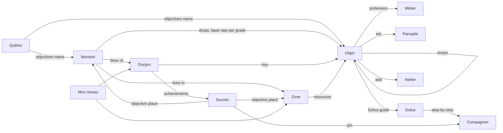

# Ecosystem architecture

How the Atlas modules connect, so a player moves between related information without searching again. Research behind it: [[Competitor Analysis]], [[Teckium Tool Analysis]], [[Desktop Companion Research]]. Data rules: [[ADR-0001 Game data from the game files]], [[ADR-0003 Link community sites, never copy them]].

## Modules and links (implemented 2026-11-21 unless marked)

Every arrow is a link on the page, and most also exist in the other direction. For example, an item sheet lists the monsters that drop it, and the monster sheet lists the item.

## Encyclopaedia (`/encyclopedie`)
- **Sheets:**
  - `monstre/<id>-<slug>`: grades, zones, drops, dungeons where it is the boss, quests and achievements;
  - `objet/<id>-<slug>`: effects, set, recipe, dropped by, harvested in, opens (dungeon key), quests that ask for it, used in recipes;
  - `donjon/<id>-<slug>`: bosses, key, zone, rooms, achievements;
  - `zone/<id>-<slug>`: monsters (regular ones apart from the rest), resources, dungeons, achievements;
  - `panoplie/<id>-<slug>`: items and set bonuses.
- **Code:** `src/encyclopedia.ts` (server) and `src/encyclopedia-shared.ts` (client-safe: URLs, `dropOdds`).
- **Index:** one index per database file, built in about 0.4 s on first use: the search list, quest↔monster and quest↔item from the objective templates (`src/objective-targets.ts`), ingredient→recipes, resource→zones, key→dungeon, and objective name→achievements. After that, a sheet loads in about 5 ms (measured locally).
- **Search:** `GET /api/encyclopedie/search?q=&kind=`. Every word must match, accents are ignored. Exact names come first, then regular monsters before summons, quest and wanted variants of the same name.
- **Drop odds** (`components/encyclopedia/DropOdds.tsx`): the exact probability over N fights from a rate. The rate starts at the game's base rate. Prospection and bonuses are **not** applied, because their rule is not in the game files.

## Atelier (`/metiers/atelier`)
- A craft list for the active character, kept in this browser (`atlas:atelier:<characterId>`).
- `GET /api/atelier?lines=id:qty,…&sub=1` adds up the ingredients using the game recipes (`src/atelier-shared.ts` `expand`):
  - optional sub-crafts, with a depth and cycle guard;
  - « J’ai » column; done crafts are left out of the totals;
  - a share link.

## Companion (`/compagnon`)
See [[Companion Window]] and [[ADR-0008 Companion window in the browser]].

## Smaller links added
- Achievement objectives that name a monster, zone or dungeon link to its sheet.
- « Où aller » dungeon rows open the dungeon sheet.
- The Succès page accepts `&a=<id>` to open one achievement.
- Names on the level page link to the sheets.
- The menu entry « Cartes » became « Encyclopédie », which links to `/carte`.

## Not built, and why
See the « Do not build » list in [[Competitor Analysis]]: prices, breaking and runes, the profession XP formula ([[ADR-0007 Profession XP comes from the player's screen]]), breeding, maps, multi-account tools.

## Next steps (planned)
1. **Sitemap and SEO:** dungeons and zones are in the sitemap since 2026-11-21 (624 URLs, every one crawled by the E2E suite). Sets, items and monsters (about 27,000) need a sitemap index and a sampled crawl.
2. **Encyclopaedia filters:** items by type and level, like the equipment page, and that page's rows linked to sheets.
3. **More companion guides:** a region's quests, a dungeon's achievements, the atelier list as a checklist.
4. **Archmonster and wanted-poster checklists** per character, from the `monster` races and zones in the data.
5. **Backup and export** of a character to a file.
