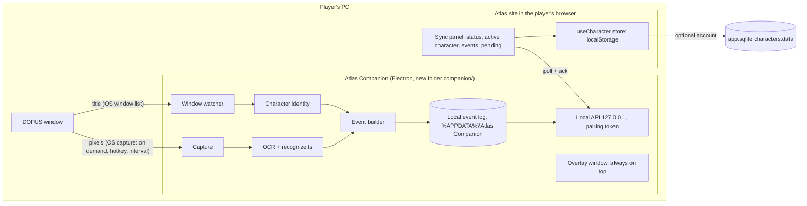

# Game companion design

Design for a Windows companion that turns what DOFUS shows on screen into progress on the player's Atlas profiles.

**Status (2026-11-25):** the design was approved. **Phases 3–6 are built and tested**: window and character ([[#10. Phase 3: built]]), quest and achievement lists ([[#11. Phases 4 and 5: built (quest and achievement lists)]]), and the sync with the site ([[#12. Phase 6: built (sync with the site)]]). Phases 7–9 are planned. Decision record: [[ADR-0009 Windows companion reads the window title and screen]].

Related:
- what exists: [[Character Sync OCR]], [[Companion Window]];
- research: [[Desktop Companion Research]];
- rules: [[ADR-0004 Scanner reads screenshots locally]], [[ADR-0008 Companion window in the browser]].

## 1. Audit (2026-11-25)

### What already exists and is reused
| Need in the brief | Already in Atlas | Where |
|---|---|---|
| OCR of quest and achievement lists | Two-level Otsu thresholding, Tesseract 6, about 2000 px upscaling. Matching against the game database, with certainty rules (`isCertain`, `isLikely`) | `components/scan/ocr.ts`, `src/recognize.ts` |
| Reading the game window | A browser window share, with list framing and automatic reading on change | `startShare` in `components/scan/ocr.ts` |
| Always-on-top overlay | Document Picture-in-Picture window | `components/companion/` |
| Several characters | Characters with a stable id, a name, a level and a class (`profile.breed`) | `src/character.ts` |
| Progress with history and undo | `done` and `active` node ids. History entries with a source (`manual`, `import`, `scan`, `prerequisites`), capped at 200 | `src/character.ts`, `components/useCharacter.ts` |
| Storage | The browser's `localStorage`. With an account, each character is also stored as one JSON blob (`characters.data`), so the server needs **no table change** to store new character fields | `src/server/appdb.ts` |
| Validation | `sanitizeCharacter`: ids `quest:N`, `ach:N`, `dungeon:N`, `obj:N`; lengths and ranges | `src/character.ts` |
| Migrations | `schema_migrations` table, applied forward | `src/server/appdb.ts` |

Notes on the brief:
- There is no src/application folder. The site is `app/` (routes), `components/` (UI) and `src/` (logic).
- The in-site map stays removed ([[ADR-0005 Remove the in-site map]]).

### What DOFUS exposes without touching the game (checked on the owner's PC, 2026-11-25)
| Source | What it gives | Use |
|---|---|---|
| **The game window's title** | `<character name> - <class> - 3.7.14.18 - Release`, read through the window list of the OS | **Character name, class and game version, with no OCR.** It changes when the player switches character, so switches are detected reliably |
| Process list | Whether `Dofus.exe` runs | Connection status |
| `%APPDATA%\zaap\gamesLogs\dofus-dofus3\*.log` | Engine, network and chat-connection messages only: no character, level, server, quest or achievement data | Not used |
| `%LOCALAPPDATA%Low\Ankama\Dofus` | Crash-reporter (Sentry) files only | Not used |
| Launcher folders (`zaap\keydata`, `certificate`, `Local Storage`) | Launcher secrets and session | **Never read** |
| An Ankama API | None for progress ([[Official Sources]]) | — |

Consequences:
- **Name and class:** reliable, from the window title.
- **Level and server:** not in the title. They can come only from OCR of a screen that shows them (character sheet, server list), or from the player.
- **Quests and achievements:** OCR of the game's lists, as the scanner does today.

## 2. Architecture


**Key choice: the website applies, the companion only observes and proposes.** The companion never writes progress itself. It produces events; the website validates them and applies them through the existing character store, with its history and undo. So:
- the site keeps working without the companion;
- the same validation (`sanitizeCharacter`) guards every write;
- progress lands where it already lives: `localStorage`, plus the account if there is one;
- no second copy of the progress can drift.

## 3. Components
| Component | Job | Built on |
|---|---|---|
| **Window watcher** | Every 2 s: is a DOFUS window open, which one is in front, what its title says. A new title means a character switch | Electron `desktopCapturer.getSources({ types: ['window'] })`, window names only |
| **Capture** | A frame of the DOFUS window: on demand, by global hotkey, or every N seconds (off by default). Optional framed region, as in the scanner | `desktopCapturer` window thumbnail at full size |
| **Recognition** | The existing OCR and matcher. The screen kind is recognised from its labels (« Terminées », « Succès »…). When the kind is unclear, the event is *pending*, never applied automatically | `components/scan/ocr.ts`, `src/recognize.ts` (shared code, not copied) |
| **Event builder** | Turns readings into events. Drops events already sent (same object, same state, same character) | §4 |
| **Local event log** | Append-only JSON lines, kept 30 days. Survives restarts and disconnections; unsent events are resent | file in `%APPDATA%\Atlas Companion` |
| **Local API** | Serves events to the site and receives acknowledgements | Node `http` on `127.0.0.1`, §6 |
| **Overlay** | Optional always-on-top window: active character, mode, last events, emergency stop | Electron `BrowserWindow({ alwaysOnTop })` |
| **Site sync panel** | On `/compagnon`, plus a status badge in the nav: connection, active character, mode, recent events, pending confirmations, last sync | New component in `components/companion/` |

## 4. Data model

### Character (extends `src/character.ts`; backward compatible, all fields optional)
| Field | Meaning |
|---|---|
| `id` | Existing stable internal id |
| `name`, `level`, `profile.breed` | Existing |
| `gameName` | The exact in-game name, from the window title. Matching uses **exact equality only, never similarity**: two characters are never merged because their names look alike |
| `server` | Declared by the player, or read from a screen that shows it. Two characters with the same name on different servers are different |
| `account` | A free label chosen by the player ("Compte principal"). **Never an Ankama login, password or token** |
| `lastSeenAt` | When the companion last saw this character in front |

History: a new source `companion`, and an optional `eventId` on each entry. The site refuses an event whose id is already in the history, which makes writes idempotent.

### Event (companion → site)
| Field | Example |
|---|---|
| `eventId` | ULID, unique |
| `characterKey` | `gameName` + `server` when known. The site resolves it to its own character `id` |
| `type` | `character.seen`, `character.level`, `quest.completed`, `quest.active`, `achievement.completed` |
| `objectId` | `quest:1093`, `ach:486`, or empty |
| `previous`, `next` | States: `unknown`, `active`, `done`; or levels |
| `at` | When it was seen: the capture time, **never a guessed completion date** |
| `confidence` | 0–1, from the matcher (`ocr`, `similarity`, `exact`, ambiguity) |
| `evidence` | `{ source: 'window-title' / 'ocr', screen: 'quests-done' / 'achievements' / …, text: <the line read> }`. No image is kept by default |
| `status` | `new` → `sent` → `applied` / `pending` / `rejected` / `ignored` |

### Evidence rules (from the brief, made strict)
- **A quest is done** only when it is read in a list recognised as the « Terminées » list. Disappearing from « En cours » proves nothing and creates no event.
- **An achievement is done** only when it is read in a list of obtained achievements. A completion date is stored only if the screen shows one.
- **Automatic mode** applies only events that pass `isCertain` (exact name, not shared with another object, OCR confidence ≥ 55 %), on a screen of a known kind, for a character already matched. Everything else is *pending*.
- **A character switch** changes the active profile only on an exact `gameName` (+ `server`) match. An unknown character produces a *pending* « create a profile? » card. Nothing is created without a click.
- Nothing is ever removed by the companion. Corrections stay manual (existing undo, unticking).

## 5. Modes and controls
| Mode | Companion | Site |
|---|---|---|
| **Observation** | Captures and recognises; events are logged | Shows them; applies nothing |
| **Assisted** (default) | Same | Every event is *pending* until the player confirms it (one click, or « tout confirmer ») |
| **Automatic** | Same | Applies the events that pass the rules above; the rest are *pending* |

- **Emergency stop:**
  - a button in the companion and in the overlay;
  - a global hotkey;
  - a « Pause » button on the site.
  
  Stopping halts capture at once and drops the queue that has not been sent yet. The log is kept.
- **History:** every event and its outcome, on the site and in the companion.

## 6. Local API and security
- **Network:** listens on `127.0.0.1` only, fixed port 47120 (configurable), never on the network.
- **Pairing:**
  - at first start, the companion creates a random 256-bit token and shows a pairing code;
  - the site stores the token in `localStorage`;
  - every request carries `Authorization: Bearer <token>`.
- **CORS:** an allow-list of the Atlas origins (`http://127.0.0.1:3101`, `http://localhost:3000`, the production domain later). Other origins are refused.
- **Endpoints:**
  - `GET /v1/status`: version, mode, DOFUS seen, active character key;
  - `GET /v1/events?after=<id>`;
  - `POST /v1/ack` (applied, rejected, pending);
  - `POST /v1/control` (mode, stop).
  
  Every body is validated with size limits and the same id rules as `sanitizeCharacter`.
- **Reconnection:** the site polls every 2 s while the page is open. After a disconnection it asks for `events?after=<last applied>`, so nothing is lost or applied twice.
- **What is never stored:** Ankama passwords, tokens, cookies, anything from the launcher's folders, captures (unless the player keeps one to report an error).
- **Git:** `companion/` builds and the local log are git-ignored. No real character names in tests or the vault.
- **Backup:** the site's existing JSON export already covers the characters. The companion log can be exported, and imported again on a new PC.

## 7. Phases (each one is tested and committed before the next)
| Phase | Delivers | Tests |
|---|---|---|
| 3. Window and character detection | `companion/` Electron app: window watcher, title parser, capture on demand and by hotkey, tray menu | Unit: title parser (all 19 class names, unknown classes, other windows); manual run with DOFUS open |
| 4. Quest recognition | Screen-kind detection, quest events, evidence rules, de-duplication | Unit: rules and de-duplication; the synthetic game lists of `e2e/scan.spec.ts` replayed through the companion pipeline |
| 5. Achievement recognition | Same for achievements | Same |
| 6. Synchronisation | Local API, pairing, site sync panel, idempotent apply, pending queue, retries | Unit: API validation, auth, CORS. E2E: a fake companion serves events; the site applies each one once, survives a restart, refuses a bad token |
| 7. Several characters | Exact matching, « create a profile? » card, account and server fields, automatic switch | E2E: two characters with close names stay apart; a switch never writes to the other character |
| 8. Overlay | Always-on-top window with status and emergency stop | Manual check over the running game |
| 9. Hardening | False detections, duplicates, disconnection, restarts | The existing suites, plus the cases above |

Each phase updates this note, [[API Documentation]], [[03 - DEVELOPMENT STATUS]] and an install guide. `CLAUDE.md` gains the companion's commands.

## 8. Limits known in advance
- **Level and server** are not in the window title. Until they are read from a screen, the player declares them.
- **OCR accuracy on real DOFUS screens has not been measured** ([[Character Sync OCR]]). Automatic mode is only as good as that measurement.
- **Telling which tab is open** (« En cours » or « Terminées ») from pixels is hard. When it is unclear, events wait for confirmation.
- **Captures of a minimised or covered window:** Windows may return a black or stale frame. In that case the companion reads nothing and says so.
- **Ankama's rules:** the companion reads the screen and the window title through Windows, like a screen recorder. It never touches the game's process, memory, network or input. Whether Ankama accepts automatic screen reading is **not confirmed** (UNVERIFIED); interval capture stays off by default.

## 9. Decisions needed
1. **Electron as a new dependency**, isolated in its own `companion/` folder with its own `package.json`, so the site gains no dependency. It is about 100 MB installed. It brings window capture by window, global hotkeys, an always-on-top window, and runs the site's TypeScript OCR code unchanged. Alternatives:
   - **Tauri:** needs the Rust toolchain, and the OCR would have to be rewritten;
   - **.NET:** the OCR and matcher would have to be rewritten.
2. **Accept the Ankama-rules risk** of §8 for a companion that captures automatically, or limit it to the hotkey only.
3. **Default mode:** Assisted (proposed).

Answered on 2026-11-25:
- Electron in `companion/`: yes;
- hotkey and interval capture both available: yes, with the interval off by default;
- default mode: Assisted.

## 10. Phase 3: built
### What it does
- **Finds DOFUS:** every 2 s, the OS window list gives the DOFUS windows. Their titles are parsed by `parseDofusTitle` in `src/game-window.ts`: character, class (mapped to the game's class id), version.
  - Hyphenated names are kept whole.
  - The login screen counts as « DOFUS ouvert, aucun personnage ».
  - Other windows are ignored, such as a browser tab about DOFUS.
- **Character switch:** a new character in a window writes a `character.seen` event to the local history and makes that window active. With several DOFUS windows, the player can pick the active one.
- **Capture:** a frame of the active window, kept in memory only, shown as a small preview. Triggers:
  - the « Capturer maintenant » button or the tray menu;
  - **Ctrl+Shift+F9**;
  - every N seconds (5–3600; 0 = off, the default).
  
  An empty or almost black frame (a minimised window) is reported and never read.
- **Modes:** Observation, Assisted, Automatic, saved in the settings. They take effect with the sync (phase 6).
- **Emergency stop:** a button, the tray menu, or **Ctrl+Shift+F12**. It stops the watcher, the interval and the hotkey capture. Pressing it again resumes.
- **History:**
  - file: `events.jsonl` in `%APPDATA%\atlas-companion`;
  - records character switches, stops and resumes;
  - kept 30 days.
- **Window:**
  - dark, in French;
  - a sandboxed renderer with a three-call bridge (`companion/preload.cjs`), no Node access, and a strict content security policy;
  - it keeps running in the tray when closed.

### Files
- `src/game-window.ts`;
- `tests/game-window.test.ts`;
- `companion/package.json` (Electron 45.3.0, released 2026-11-10);
- `companion/main.mjs`;
- `companion/preload.cjs`;
- `companion/ui.html`.

Electron's Node (24.22) loads the site's TypeScript files directly, so `src/` code is shared with no build step.

### Install and run (owner's PC)
1. Install the dependencies:
   ```
   cd companion
   npm install
   ```
2. Start the companion:
   ```
   npm start
   ```
3. Start DOFUS and enter the game with a character: the companion window shows « <name> · <class> · <version> ».
4. Self-test without a window: `npx electron . --self-test`. It prints the classes and versions seen, and one capture's size (no names).

### Troubleshooting
| Symptom | Cause / fix |
|---|---|
| « DOFUS non détecté » with the game open | The title is not « name - class - version - channel » (for example during a patch). Check the game's title bar |
| « Image presque noire » | The DOFUS window is minimised. Restore it; it may stay behind other windows |
| The hotkey does nothing | Another program uses Ctrl+Shift+F9 or F12. Close it, or change the constants in `companion/main.mjs` |
| Two DOFUS windows | Pick the active one in « Fenêtre active » |

### Tests (2026-11-25)
- `npm run typecheck`: clean. `npm test`: 111/111, including 3 new title-parser tests (every one of the 19 class names, login screens, other windows).
- **Real game:** with DOFUS 3.7.14.18 running, the self-test found the window, read the class (Huppermage, id 17) and the version, wrote one `character.seen` event, and captured a 3840 × 2160 frame with no black pixels.
- **Not tested yet:**
  - capture of a window covered by another window;
  - two DOFUS windows at once;
  - a live character switch;
  - the hotkeys from inside the game.
- The capture box is 3840 × 2160. Whether Windows scales a smaller window up to that size, or returns it at its own size, was not checked.

## 11. Phases 4 and 5: built (quest and achievement lists)
### What it does
- **The player says which list is shown** with « Ce que j’affiche dans DOFUS »: *Quêtes terminées*, *Succès obtenus*, or *Rien à lire* (the default, capture only).
  - This replaces the label-based screen detection planned in §3. Which tab is open in the game cannot be told reliably from pixels, and the player's declaration is the stronger evidence.
  - The list's title (« Terminées », « Succès / Obtenus ») is still looked for and recorded as `signSeen`. When it was not read, a warning is shown.
- **Framing:** drag on the capture preview to frame the list. Only that part is read, and the frame is kept in the settings.
- **Reading:**
  - the same thresholding as the browser scanner, now shared in `src/threshold.ts`;
  - upscaling to about 2000 px (Electron's `best` resize);
  - Tesseract 6.0.1 (French) in the background process;
  - the site's matcher (`src/recognize.ts`).
- **Evidence rules** (`src/companion-read.ts`, unit tested):
  - only a declared list can prove a completion;
  - `certain` = the scanner's `isCertain`; « likely » readings are logged as « à confirmer »;
  - a name shared by two objects of the same kind gives nothing;
  - absence proves nothing.
- **Events:** `quest.completed` / `achievement.completed` with:
  - the object id, the name, the character (from the window title), `certain` and the confidence;
  - `evidence` (`ocr`, the declared list, the line read, `signSeen`, the version of the game data);
  - `at` = the capture time, never a completion date.
- **No duplicates:** an event is never logged twice for the same character, type and object. The log is reloaded at start.
- **Without a character in game** (login screen), nothing is read.
- **At an interval,** a list is read again only when the framed part changed. The detector is the same as the browser share's.
- **Game names** come from the site's public `/api/graph` (setting `atlasUrl`, default `http://127.0.0.1:3101`). They are cached in `game-names.json`, so reading still works when the site is down.
- A version mismatch between the site's data and the game is shown.
- « Voir le texte lu » shows the raw OCR text of the last read.

### Tests (2026-11-25)
- **Unit:**
  - `tests/companion-read.test.ts`: the evidence rules;
  - `tests/threshold.test.ts`: the shared thresholding, in RGBA and BGRA, on dark and light captures.
  
  `npm test`: 117/117. Typecheck clean.
- **Browser scanner after the refactor:** `e2e/scan.spec.ts` desktop, 4/4 passed on a fresh production build.
- **The companion pipeline on the scanner's synthetic game lists** (`--self-test-read`):

  | List | Read | Certain |
  |---|---|---|
  | 7 quests, PNG | 7 | 7, every id right |
  | 5 achievements, compressed JPEG | 4 | 4 |

  The missed one, « Belladone (Mains Propres) », was read « Befadone ». That puts it under the matcher's 0.8 floor, so it is not proposed, which is safe. Electron's `good` and `better` resize qualities did worse (5–6 found, 1–5 certain).
- **Real game, whole window, quest window closed:**
  - 109 OCR lines in 8.9 s;
  - **0 names found, 0 events**: the scene, chat and panels gave no false completion;
  - list title not seen, as expected.
- **Companion window:** `--self-test-ui` renders a sample state with no renderer error. Found and fixed: the « Fenêtre active » picker showed with one window (CSS `display: flex` overrode `hidden`).
- **Not tested yet:**
  - a real « Terminées » list or obtained-achievements list in the game;
  - scrolling with interval reading on the real game.

### Still to come
- Phase 6: the site reads the events (local API, pairing, pending queue, modes applied).
- Phase 7: profiles matched by exact name.
- Phase 8: the overlay.

## 12. Phase 6: built (sync with the site)
### How it works
- **Companion:**
  - serves its events on `127.0.0.1:47120` (`companion/api.mjs`; endpoints in [[API Documentation]]);
  - keeps the site's answer for each event in its log (`{ ack, status }` lines);
  - shows « Site relié » or the time of the last call, and the pairing code, with « Copier le code » and « Nouveau code ».
- **Site** (`components/companion/companion-sync.ts`, panel `components/companion/CompanionSyncPanel.tsx` on `/compagnon`, badge in the nav):
  - once paired, it polls every 2 s (5 s when disconnected) on every page;
  - it validates each event (`parseEvent`) and decides (`decide`, in `src/companion-sync.ts`);
  - it writes through the character store (`updateCharacterById`), then acknowledges.
  - The pairing code, the last event read and the pending list are kept in `localStorage` (`atlas:companion:v1`).
- **Decisions:**

  | Event | Linked profile (exact `gameName`) | No profile |
  |---|---|---|
  | `character.seen` | that profile becomes active; `lastSeenAt` is set, and the class if it had none | « Nouveau personnage vu dans DOFUS » card: *Créer son profil*, *Associer* to a profile with no in-game name yet, or *Ignorer* |
  | completion, Observation mode | noted, not written | noted |
  | completion, Assisted mode | waits for *Confirmer* / *Refuser* (or *Tout confirmer*) | waits for the profile |
  | completion, Automatic mode | written if `certain`, otherwise waits | waits for the profile |
  | completion already in the history (same `eventId`) or already done | ignored | — |

- **Where completions go:** always to the profile of the character that was **seen**, never to the active one by default. A profile linked later gets its waiting readings re-decided.
- **Idempotent:** the history entry keeps the `eventId`, and it survives the account's server copy. After a page reload, or a companion that sends everything again, nothing is applied twice.
- **Emergency stop and mode** can be changed on the site too (`POST /v1/control`).
- **The site without the companion:** nothing calls `127.0.0.1:47120` until it is paired (E2E-checked), and no badge is shown.
- **Data model:** see [[Database Schema]] (optional character fields, no table change).

### Tests (2026-11-25)
- **Unit:**
  - `tests/companion-sync.test.ts`: validation, exact names, the three modes, idempotency, the server round trip, sightings;
  - `tests/companion-api.test.ts`: token, origin, Host, events after an id, acknowledgements, controls, 413.
  
  `npm test`: 125/125.
- **E2E `e2e/companion-sync.spec.ts`:** a stand-in companion built on the real `companion/api.mjs`, on port 47120, and the real site. It checks:
  - a wrong code is refused;
  - pairing works;
  - a new character gets a card and no profile without a click; then profile creation and the class;
  - Assisted mode waits, then confirms;
  - Automatic mode writes the certain readings, holds the uncertain one, and leaves the other profile untouched;
  - a close name (`Abc-Deff`) gets its own card, then is linked to an existing profile;
  - after a reload plus a full replay, nothing is applied twice;
  - the emergency stop from the site reaches the companion;
  - a disconnection, then a reconnection.
  
  A second test checks that nothing calls the companion without pairing.
- **Full E2E suite** (desktop and mobile): **65 passed, 1 skipped** by design, 0 failed.
- **Real companion:**
  - its API answers 401 without a token;
  - the pairing code now survives restarts (bug found and fixed: the code was made at each start without being saved);
  - the panel renders on the real site with no console error.
  
  **Not checked:** pairing the real companion with the site and seeing a real character arrive. That needs the owner to paste the code; copying it from the settings file was refused by the session's permission rules, so it was not done.

### Limits
- The site applies events only while one of its pages is open in the browser.
- On a production https site, Chrome asks the player to allow access to the local network the first time. Not tested (not deployed).
- The pending list lives in the browser where the site is open. Another browser sees the result once applied, through the account, but not the waiting cards.
